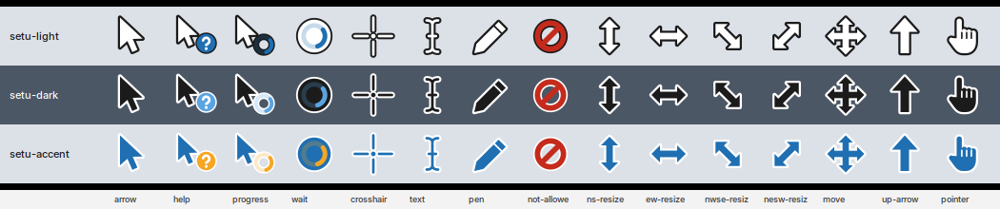

# Generated cursors

`cursorgen.py` draws 15 cursors as vectors on a 32-unit grid and writes
each one in both formats Setu needs:

- **Windows** `.cur` (32, 48, 64 px) and animated `.ani` (busy cursors,
  12 frames) for Wine programs, plus `cursors.ini`, the lines for a pack's
  `.theme` `[Control Panel\Cursors]` section;
- **X cursor theme** (24, 32, 48, 64 px, with the usual alias names) for
  labwc and Linux programs.

| Set | Look |
|---|---|
| setu-light | white with a dark outline (the default) |
| setu-dark | black with a white outline |
| setu-accent | Setu blue with a white outline, orange highlights |

    python3 cursorgen.py list
    python3 cursorgen.py build -o out    # out/<set>/windows/, out/<set>/x11/<set>/
    python3 cursorgen.py sheet -o preview.png

Formats from public documentation only: the CUR/ICO directory with hot spots
and RIFF ACON (learn.microsoft.com), Xcursor files (libXcursor's Xcursor(3)).
Original artwork, MIT OR Apache-2.0. Needs python3-cairo.
