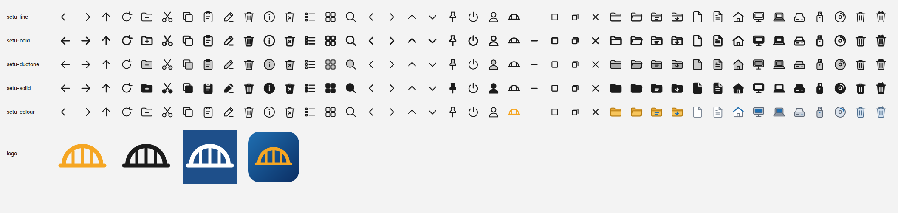

# Generated icon sets and logo

`icongen.py` draws every Setu icon once, as simple geometry on a 24-unit
grid, with each part tagged by its role (body, detail, cut-out, emblem). A
set decides how the roles are painted, so one drawing gives five complete,
consistent sets:

| Set | Look |
|---|---|
| setu-line | thin 1.5 px outlines (the default, matches DESIGN.md) |
| setu-bold | 2.25 px outlines, easier to see |
| setu-duotone | outlines over a soft tinted fill |
| setu-solid | filled shapes with cut-out details |
| setu-colour | full-colour folders, files, drives and bin; line glyphs elsewhere |

    python3 icongen.py list
    python3 icongen.py build -o sets      # sets/<set>/<name>.svg + index.ini, sets/logo/
    python3 icongen.py sheet -o preview.png

Covered: navigation and file commands, view and search glyphs, start-menu
glyphs (pin, power, user, the Setu logo), window caption buttons (minimise,
maximise, restore, close), and places/objects (folders, files, home,
desktop, computer, drives, recycle bin). Names follow
distro/themes/ICONS.md. Monochrome icons are drawn in `#1B1B1B`; Setu tints
them to the theme's colour, so every set works in light and dark packs.

The logo (`sets/logo/`): the orange bridge mark, mono and white versions,
and an app tile (the mark on a rounded Setu-blue square) for the installer,
the start button and app icons.

All original artwork, MIT OR Apache-2.0. Needs python3-cairo; the preview
also needs librsvg's GObject bindings (gir1.2-rsvg-2.0).
