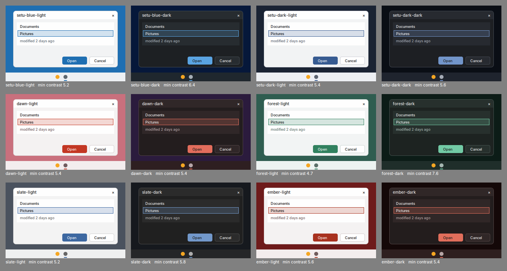

# Generated colour schemes

`schemegen.py` turns each wallpaper palette (art/wallpapers) into a light
and a dark colour scheme: 12 in all. The accent comes from the palette, the
greys get a faint tint of the palette's hue, and every pair that matters
(text on surfaces, text on the accent, secondary text, title bar, taskbar)
is adjusted until it reaches WCAG contrast 4.5:1. `list` exits 1 if any
scheme falls short.

    python3 schemegen.py list
    python3 schemegen.py ini dawn-dark     # theme.ini for one scheme
    python3 schemegen.py build -o out      # out/<scheme>/theme.ini
    python3 schemegen.py sheet -o preview.png

Each theme.ini (docs/THEMES.md) sets `[Colors]`, inherits everything else
from `setu-light` or `setu-dark` through `Base=`, and names a matching
wallpaper from the generated collection (`[Wallpaper] collection=`).

Original work, MIT OR Apache-2.0.
