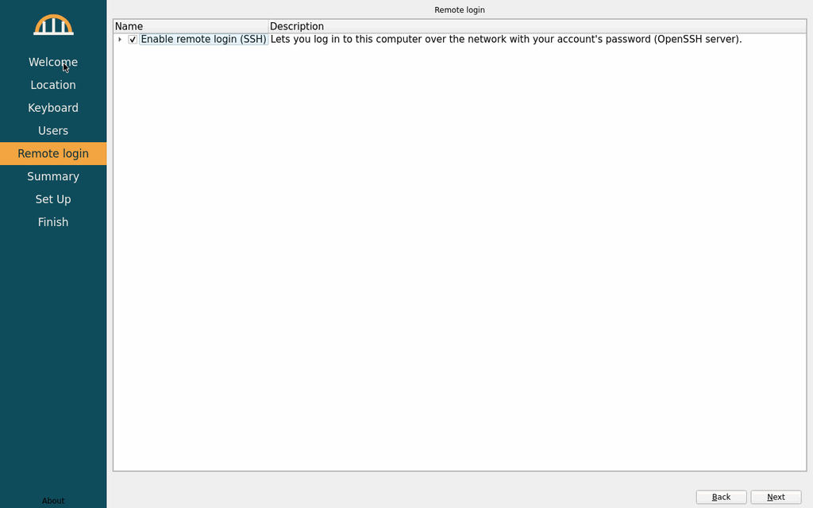
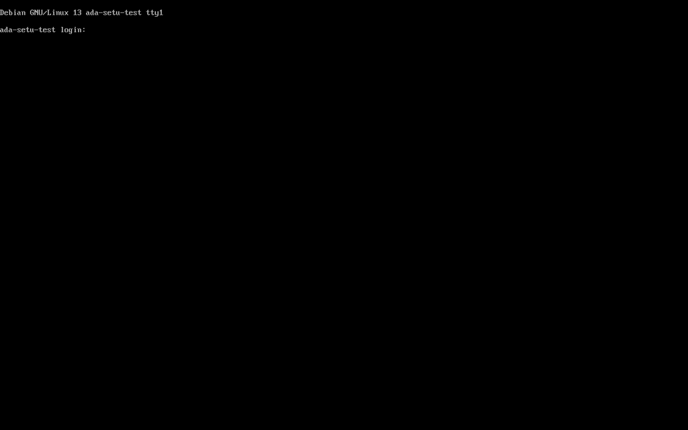
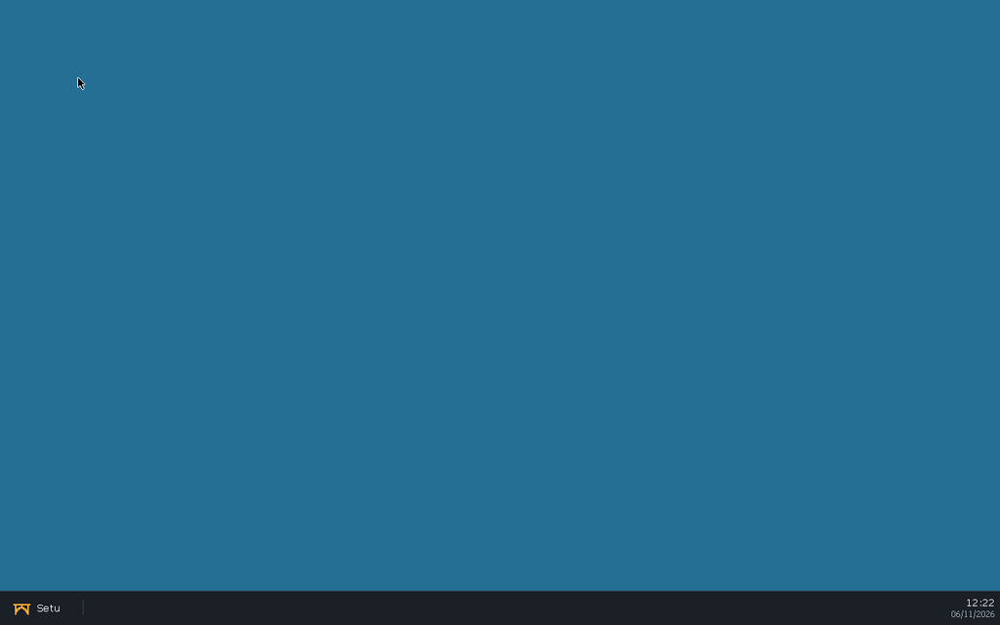
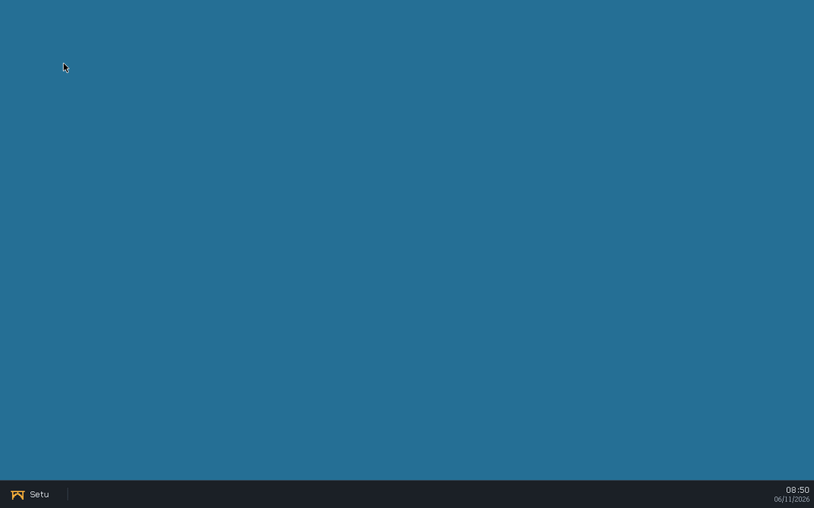
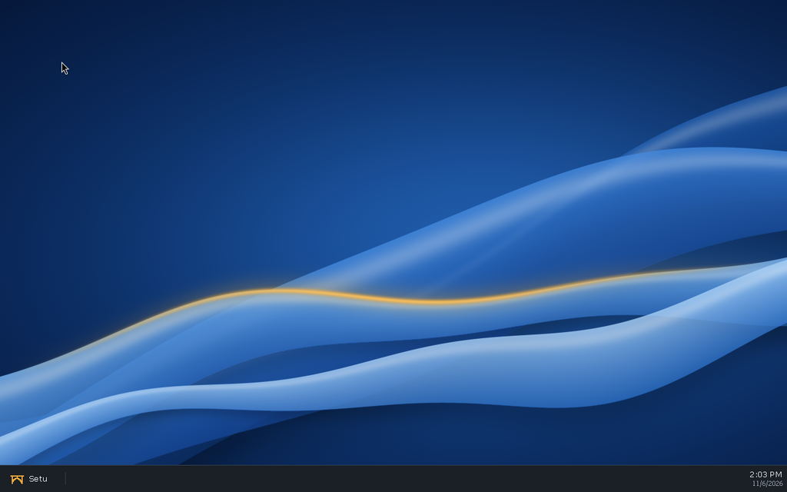
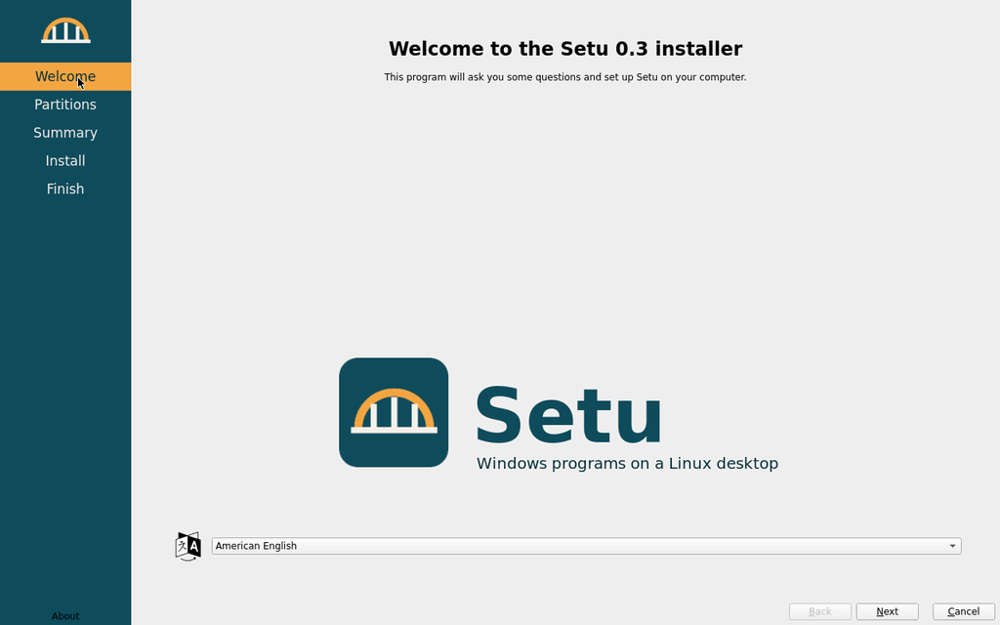
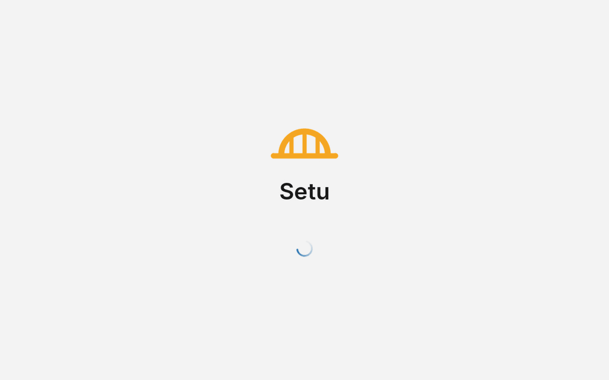
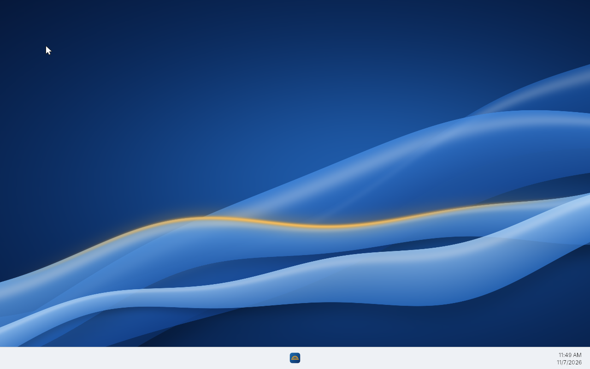
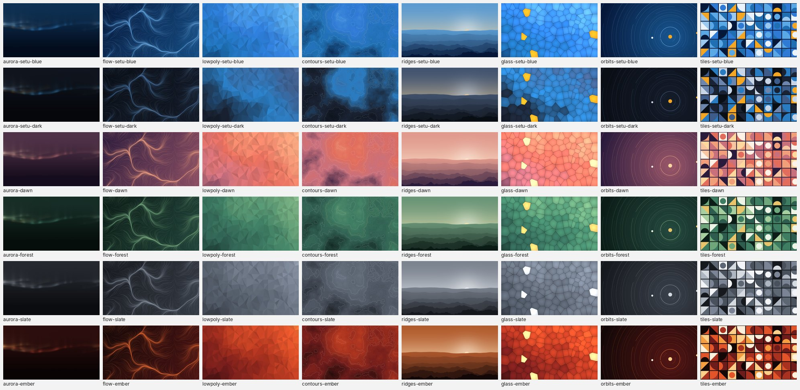

# distro/: bootable Setu image

License: MIT OR Apache-2.0 (the image itself aggregates many packages under
their own licenses).

## Milestone 1: QEMU dev image

A Debian stable (trixie) disk image that boots with UEFI in QEMU, autologs in
the `setu` user and starts a Wayland session: **labwc** (compositor, starts
Xwayland on demand) → **`setu-session`** → the Setu personality (wineserver) →
the shell (`setu-shell.exe` with `--shell`, else Wine's `notepad` as a
placeholder).

All Windows programs share one personality desktop, `setu`: a single
fullscreen Xwayland window sized to the display's preferred mode (read from
`/sys/class/drm`; override with `SETU_RES=WxH`). The personality draws every
window inside it, so labwc never decorates or places them, and the shell's
taskbar and work area apply to all programs. labwc's config
(`rootfs/etc/xdg/labwc/`) turns off server-side decorations, its key
bindings and its root menu.

```sh
distro/build-image.sh     # ~20 min; writes build/distro/setu-dev.qcow2
distro/run-qemu.sh        # VNC 127.0.0.1:5911, serial log build/distro/run/serial.log
```

`--help` on either script lists the flags. The useful ones:

* `build-image.sh --wine=debian`: use Debian's wine packages instead of the
  Setu personality build (default `--wine=setu` copies
  `<main checkout>/build/personality/install` to `/opt/setu/personality`).
* `build-image.sh --shell path/to/setu-shell.exe`: install the shell; the
  session then runs it instead of notepad.
* `build-image.sh --personality DIR`: the personality install to copy (e.g.
  a worktree's `build/personality/install`).
* `build-image.sh --no-apps`: leave out the default apps (below).
* `run-qemu.sh --snapshot`: throw away disk writes.
* `run-qemu.sh --run-dir DIR --vnc N --ssh-port N`: run a second VM next to
  the first (own monitor socket, pid file and serial log).

Login: user `setu`, password `setu` (passwordless sudo; dev image only).
SSH: `ssh -p 2230 setu@127.0.0.1`.

### Default apps: `distro/tests/apps-smoke.sh`

The image and the ISO come with 13 Windows programs installed in
`C:\Program Files` (Firefox, LibreOffice, SumatraPDF, Notepad++, 7-Zip,
ImageGlass, GIMP, Inkscape, VLC, KeePassXC, PuTTY, WinSCP, ShareX; Windows
Terminal is left out until it runs), Start menu shortcuts for them and for Wine's WordPad and
Clock, and a default app for each common file type. `build-image.sh`
downloads the vendors' official installers (pinned by SHA-256 in
`apps/apps.toml`, cached in `build/distro/downloads/apps` and never
committed) and runs them silently on the build host (`apps/stage.py`); the
files go onto C:, and each user's prefix imports the registry entries at
login (`setu-apps-register`). They add about 4 GB to C:. Design, versions,
licences, how to update a pin and the per-app results:
[docs/DEFAULT_APPS.md](../docs/DEFAULT_APPS.md).

### .NET: Wine Mono

The image (and the ISO) has **Wine Mono 10.4.1**, the .NET Framework
replacement that the personality's `mscoree.dll` loads (Wine 11.0 asks for
that version in `dlls/appwiz.cpl/addons.c`). `build-image.sh` downloads
`wine-mono-10.4.1-x86.tar.xz` from <https://dl.winehq.org/wine/wine-mono/10.4.1/>,
checks it against a pinned SHA-256 (it has the same files as the MSI whose
SHA-256 Wine pins), caches it in `build/distro/downloads` (never in git) and
unpacks it into `/opt/setu/personality/share/wine/mono/wine-mono-10.4.1`.
New prefixes find it there and don't ask to download it, so `setu-session`
only turns off `mshtml` (Gecko, not bundled) in `WINEDLLOVERRIDES`.
Licence: Wine Mono's own code is MIT; parts of it are under the GPL and the
LGPL (Mono), and its components carry their own licences (MIT, MS-PL,
zlib, BSD); see its `COPYING` and the source tarball next to the binary
one. NOTICE §4. `msi-smoke.sh` and `install-smoke.sh` check it: they compile
`tests/dotnet-hello.cs` in the guest with Wine Mono's own `mcs.exe` and run
it.

### Installing a program: `distro/tests/msi-smoke.sh`

The end-to-end check for "the shell boots in a VM": it boots the image with
`--snapshot` (VNC :21, SSH 2233, run dir `build/distro/msi-smoke/run`), waits
for the session, then over SSH starts Notepad with the shell's run box
(`setu-shell.exe --run`), installs a third-party MSI silently
(`msiexec /i FILE /qn`), starts the installed program the same way, checks
each window appears (`setu-probe.exe windows`), takes a QEMU screendump and
powers the VM off.

```sh
make -C shell                 # setu-shell.exe and setu-probe.exe
distro/build-image.sh --shell build/shell/setu-shell.exe
distro/tests/msi-smoke.sh     # downloads 7-Zip's .msi on first use
```

`--msi FILE --exe 'C:\path\program.exe'` tries another package. The default
is 7-Zip 26.05 x64 (<https://www.7-zip.org/a/7z2605-x64.msi>; GNU LGPL with
BSD-3-Clause parts and the unRAR restriction). It installs into
`C:\Program Files\7-Zip` and 7-Zip File Manager runs on the Setu desktop:


The interactive install (`msiexec /i FILE`, no `/qn`) works too, clicked
through by hand with `setu-probe click`: Welcome, licence, Custom Setup,
Ready, Finish, and the files land in `C:\Program Files\7-Zip`. The wizard
has cosmetic gaps (see below).

### C: and drive letters: `distro/tests/drives-smoke.sh`

The disk has three partitions: the ESP, the Linux root (`setu-root`, 6 GiB
by default, `--root-size`) and **`C:`** (`setu-c`, the rest of `--size`,
20G by default, 12G with `--no-apps`): an ext4 file system made with `-O casefold`, mounted at
`/var/lib/setu/volumes/c`, with `+F` on its root, so the kernel looks names
up without regard to case and keeps their case. The `setu` user's prefix
links its `c:` straight to it. Other volumes get drive letters from the
drive-letter service: the table `/run/setu/dosdevices` (C: fixed, the next
free letter from D: for each volume udev reports), followed by every
session. Details: [services/fs/README.md](../services/fs/README.md).

`drives-smoke.sh` boots a snapshot (VNC :22, SSH 2234, run dir
`build/distro/drives-smoke/run`) and checks: `lsattr -d` shows the casefold
flag on the volume behind C:; `C:\Test\MixedCase.txt` made with cmd is found
as `c:\test\mixedcase.TXT` and listed as `MixedCase.txt`; a FAT USB stick
plugged in through the QEMU monitor (`drive_add` + `device_add
usb-storage`) becomes `D:` (GetLogicalDrives, GetDriveType,
GetVolumeInformation, `dir D:`), a second disk `E:`, and unplugging
(`device_del`) removes the letter again. The disk images are made on the
host without root (`mkfs.vfat -C` + `mcopy`, `mkfs.ext4 -d`). Then it runs
`msi-smoke.sh`.

```sh
make -C shell
distro/build-image.sh --shell build/shell/setu-shell.exe
distro/tests/drives-smoke.sh      # [--msi FILE] [--no-msi]
```


### How it builds without root

The host has no sudo and no `newuidmap`, so `mmdebstrap --mode=unshare` and
other rootless tricks are out. Instead, `build-image.sh` boots a throwaway
KVM **builder VM** (Debian's official `generic` cloud image, checksummed,
configured by a cloud-init seed made with `mkfs.vfat` + `mtools`). Inside it,
`builder/build-rootfs.sh` runs as root: it partitions the output disk (GPT:
ESP + ext4 root), runs `mmdebstrap`, copies the overlay and the personality
(read-only 9p shares), and installs GRUB to the removable EFI path. The VM
then powers off and the raw disk is converted to qcow2. Each build starts
from a fresh builder, so it is repeatable; artifacts live in `build/distro/`.
`build-iso.sh` (`build-image.sh --kind iso`) uses the same builder: the root
file system goes to a directory instead of a partition, and the ISO image is
written to the raw output disk, which the host truncates to its size.

### Files

| Path | What |
|---|---|
| `build-image.sh` | host-side driver (download, builder VM, output); `--kind iso` for the installer |
| `build-iso.sh` | `build-image.sh --kind iso`: `build/distro/setu-installer.iso` |
| `builder/build-rootfs.sh` | runs as root in the builder VM (disk image or ISO) |
| `layout.env` | the disk layout (ESP, root, C: sizes, names, labels, GPT types), read by the builder and the installer |
| `rootfs/usr/lib/setu/setu-cvol-init` | makes an ext4 volume into C: (casefold, label, `lost+found` hidden); used by both |
| `installer/` | the ISO's extra packages, GRUB menu, Calamares config and branding, first-boot wizard |
| `themes/` | the theme packs' sources and their build (section "Theme packs" below) |
| `rootfs/usr/lib/setu/setu-theme-linux`, `setu-theme-sync`, `setu-boot-theme` | the active pack for labwc and the cursor, the system's packs on C:, the boot splash (all run by `setu-session`) |
| `packages.list` | packages in the image (`packages-wine-debian.list` for `--wine=debian`) |
| `rootfs/` | files copied into the image as-is |
| `rootfs/usr/local/bin/setu-session` | the session launcher (personality, active theme pack, desktop size, shell) |
| `rootfs/etc/xdg/labwc/` | labwc config: no decorations, key bindings or root menu (`menu.xml`); the theme, fonts and cursor environment are rendered from the default pack into the image's `/etc/xdg/labwc` and from the active pack into `~/.config/labwc` |
| `rootfs/etc/systemd/system/setu-session.service` | tty1 autologin running `labwc -S setu-session` |
| `../services/fs/` | drive-letter service and its units, installed by `build-image.sh` |
| `run-qemu.sh` | boots the image (OVMF, virtio-gpu, VNC, serial log, monitor socket) |
| `tests/msi-smoke.sh` | boots a snapshot, installs and runs an .msi over SSH, screendump |
| `tests/drives-smoke.sh` | casefold C: and drive-letter hot-plug checks, then `msi-smoke.sh` |
| `tests/install-smoke.sh` | installs from the ISO on a blank disk, runs the first-boot wizard, checks the result |
| `tests/install-answers.conf` | test-only account, checkbox answers and expected locale for `install-smoke.sh` |
| `tests/dotnet-hello.cs` | the .NET program the smoke tests compile and run with Wine Mono |
| `tests/lib.sh` | helpers shared by the smoke tests (boot, SSH, wine in the session, screendump, keys) |
| `docs/` | screenshots of the booted session |


Without `--shell` the session runs notepad instead ([screenshot](docs/session.png)).

### Known gaps

* `winedmo.so` (media decoding) links the build host's FFmpeg 6 sonames
  (`libavcodec.so.60`); Debian trixie ships FFmpeg 7, so it doesn't load in
  the image. Everything else in the personality resolves.
* The Linux root file system is plain ext4; only `C:` is casefolded. The
  installer makes the same layout (`layout.env`).
* MSI wizard UI (7-Zip's): the Custom Setup page shows the dialog's
  placeholder text ("Neque porro quisquam...") instead of the selected
  feature's description and the install location, the Welcome/Finish pages
  have no banner bitmap, and the licence checkbox is already ticked on first
  view. Not yet compared with Windows on the oracle.
* No 3D: QEMU's `virtio-vga` without virgl, so labwc uses the pixman renderer
  and Xwayland falls back to software (glamor off).

## Milestone 3: installer ISO and first-boot wizard

```sh
make -C shell
distro/build-iso.sh --shell build/shell/setu-shell.exe   # build/distro/setu-installer.iso
distro/tests/install-smoke.sh                            # install it in QEMU, end to end
```

`build/distro/setu-installer.iso` is a hybrid UEFI image (it boots from a
CD or, written with `dd`, from a USB stick). It starts a Debian live system
whose only program is the **Calamares** installer (Debian's package, GPL-3)
with Setu branding (`installer/rootfs/usr/share/calamares/branding/setu/`,
our own artwork from `artwork/branding.py`, in the docs/DESIGN.md look).

### How the ISO is built

`build-iso.sh` is `build-image.sh --kind iso`: the same rootless builder VM
and the same root file system as the dev image (`packages.list`, `rootfs/`,
`services/fs`, the personality, the shell) plus `installer/` (its
`packages.list` and `rootfs/`). Instead of partitioning a disk,
`builder/build-rootfs.sh` builds into a directory, squashes it
(`live/filesystem.squashfs`, xz) and runs `grub-mkrescue`, which writes an
ISO with an El Torito EFI image, an appended EFI partition and a protective
MBR (that is what makes it hybrid). The builder writes the ISO to the start
of its output disk; the host cuts the raw disk to the ISO's size.

Why our own squashfs + `grub-mkrescue` instead of live-build: the builder
already makes the root file system with mmdebstrap, so the live system *is*
the system the installer copies, with no second build recipe. live-build
would rebuild it its own way (and needs root on the host or its own VM all
the same). The pieces we need from Debian Live are just `live-boot` (finds
the squashfs on the medium and overlays a tmpfs) and Calamares.

### The installer

`setu-live-installer.service` (only with `boot=live` on the kernel command
line) runs labwc on tty1 with Calamares as root. Calamares
(`installer/rootfs/etc/calamares/`) asks one question, which disk to erase
(Welcome, Partitions, Summary), then:

| Job | What |
|---|---|
| `partition` | GPT: ESP, `setu-root`, `setu-c` (the rest, ext4 with `casefold`) |
| `mount` | the new partitions under Calamares' root mount point |
| `shellprocess@cvol` | `setu-install cvol`: `setu-cvol-init` on the C: volume (casefold flag, label, hidden `lost+found`) |
| `unpackfs` | the live squashfs onto the new root |
| `machineid`, `fstab` | a new machine id; fstab with all three partitions |
| `packages` | removes `live-boot` (offline) |
| `shellprocess@target` | `setu-install target`: puts the first-boot wizard's config in `/etc/calamares` |
| `initramfs`, `bootloader` | initramfs without live-boot; GRUB on the ESP (NVRAM entry "Setu" + removable path) |

The layout has one source of truth, **`layout.env`**: `build-rootfs.sh`
partitions the dev image with it and turns it into Calamares'
`partition.conf` (`installer/partition.conf.in`). Making a volume into C:
(`rootfs/usr/lib/setu/setu-cvol-init`) is shared too. The live system keeps
`setu-drives` and `setu-volume@` off (drop-ins), so they don't mount the
disk being partitioned.

Language, keyboard, time zone, the account and the computer name are *not*
asked by the installer: the installed system asks them once, on its first
boot, so there's one place for them (the OEM pattern: the installer can be
run by someone other than the user).

### The first-boot wizard: Calamares in OEM mode

On the installed system `setu-firstboot.service` runs before the session
(only while `/var/lib/setu/firstboot.done` doesn't exist): labwc + Calamares
with `/etc/calamares` = `installer/rootfs/usr/share/setu/firstboot/calamares/`
(`dont-chroot: true`, `oem-setup: true`, no Cancel). Pages: Welcome
(language), Location (time zone, system locale), Keyboard, Users (full name,
login name, computer name, password, "Log in automatically"; the account
goes in `sudo`, root stays locked), Remote login (one checkbox, "Enable
remote login (SSH)", off by default), Summary, **Set Up**. Its jobs are
Calamares' own `locale`, `keyboard`, `localecfg` and `users`, our
`remotelogin`, then `setu-firstboot-finish USER`: `setu-session.service` gets `User=USER`
and the chosen XKB layout (drop-ins), C: is chowned to USER,
`firstboot.done` is created, and the wizard's unit disabled and its config
removed. When the unit stops, `setu-firstboot-handoff` starts the session
or the login prompt.

* **Log in automatically** (ticked by default): the account is in the
  `autologin` group (Calamares' `autologinGroup`), so the finish script
  enables `setu-session.service`, the tty1 autologin of the dev image.
  Unticked: `setu-session.service` stays off and tty1 has the normal
  `getty` login prompt; after the password, `/etc/profile.d/setu-session.sh`
  starts the same session (`labwc -S setu-session`, same environment and
  keyboard layout) in the login's logind session. Logging out of the
  session (quitting labwc) goes back to the prompt. No greeter package: the
  console login is already there and is all this needs.
* **Enable remote login (SSH)**: `setu-install target` disables `ssh` on
  the installed system (the live system and the dev image keep it on).
  Calamares has no plain checkbox page, so the checkbox is a `netinstall`
  group (`modules/netinstall.conf`) whose package is `openssh-server`
  (already installed, and nothing is installed: there is no `packages`
  job). netinstall records the ticked group's packages in Calamares'
  GlobalStorage; the small Python job `modules/remotelogin/` finds
  `openssh-server` there and runs `setu-firstboot-ssh`, which enables and
  starts `ssh`. (A netinstall group's own `pre-install` script would be
  simpler, but Calamares 3.3.14 never runs it.)

Why Calamares and not a program of our own: it is already on the medium
(the live system and the installed system are one squashfs), its users,
locale and keyboard modules are the tested code for exactly these files
(`useradd`, sudoers, `/etc/hostname`, `/etc/default/locale`, `locale-gen`,
`/etc/localtime`, `/etc/default/keyboard`), it is translated, and it looks
like the installer the user just saw. OEM mode (`dont-chroot`) is a
documented Calamares setup for this. The cost is Qt and parts of KDE
Frameworks staying in the installed system, which a small dedicated
program would avoid. If Calamares quits before the wizard is done,
`setu-firstboot-session` starts it again.

### `distro/tests/install-smoke.sh`

QEMU (4 GB, q35, OVMF), a blank 20 GB qcow2 and the ISO as a CD-ROM
(VNC :24, SSH 2236, run dir `build/distro/install-smoke/run`). The test
drives Calamares through the keyboard, as a user would (QEMU `sendkey`:
the buttons' Alt shortcuts, Tab between fields): Calamares has no
unattended mode, and a test-only config would not test the real one. It
waits for the end of each phase in the serial log (the units and
`setu-install`/`setu-firstboot-finish` log there), types the account from
the test-only answers file `tests/install-answers.conf` (with "Log in
automatically" and "Enable remote login (SSH)" ticked), then checks over
SSH as that account: the session's taskbar, hostname/locale/time
zone/keyboard/groups/sudo, autologin and `ssh` enabled, C: on the `setu-c`
partition with the casefold flag (a file made by cmd found in another
case), setu-ntacld (a DACL set from Windows lands in `security.NTACL` and
is enforced), .NET (Wine Mono compiles and runs `tests/dotnet-hello.cs`),
the wizard unit disabled and `live-boot` gone; then it reboots and checks
the session comes back without the wizard. Then it installs again on a new
blank disk with both checkboxes unticked: the wizard must report a password
login with `ssh` disabled (serial log) and the guest's SSH port must not
answer; tty1 must show a text console (screendump), where the test logs in
with the account's password, and the Setu desktop must come up
(screendump). `--scenario answers|unticked` runs one of the two installs
(about 7 minutes each). Screendumps of each stage: `docs/install-*.png`.
The scratch disk and UEFI variables are deleted at the end.









The other stages: [summary](docs/install-summary.png),
[finished](docs/install-finished.png), first boot
[welcome](docs/install-firstboot-welcome.png),
[location](docs/install-firstboot-locale.png),
[keyboard](docs/install-firstboot-keyboard.png),
[summary](docs/install-firstboot-summary.png).

### Known gaps (installer)

* UEFI only (no BIOS boot), no Secure Boot.
* The password login is the text console's `login:` prompt, not a
  graphical greeter.
* The SSH checkbox looks like a package list (Calamares' `netinstall`
  page), with one entry.
* Calamares pulls in Qt 6 and parts of KDE Frameworks (part of the
  2.5 GB root file system) and stays installed, because the first-boot
  wizard is Calamares too.
* The installer erases a whole disk; there is no manual partitioning, no
  install alongside another system and no encryption.

## Milestone 3: Setu's look (fonts, wallpaper, cursors, boot, installer)

The image's part of Setu's visual design ([docs/DESIGN.md](../docs/DESIGN.md));
the control theme and window frames are the personality's
(`personality/wine`), the taskbar, start menu and file manager the shell's
(`shell/`). Everything here is in both the dev image and the ISO (so in
installed systems too). Licences: NOTICE §5.

| What | Where | Notes |
|---|---|---|
| Fonts | `packages.list`: `fonts-inter`, `fonts-jetbrains-mono`, `fontconfig`; `rootfs/etc/fonts/local.conf` | The personality enumerates fonts through fontconfig, so Windows programs see **Inter** and **JetBrains Mono** (and DejaVu); the personality's `FontSubstitutes` (wine.inf) map the Windows UI face names to Inter. For Linux programs (Calamares, foot, labwc) `sans-serif` is Inter and `monospace` JetBrains Mono; antialiased, slight hinting, grayscale. |
| Font smoothing | the pack's `[Fonts] smoothing`, applied by `setu-theme` | Grayscale by default: Xwayland renders in software and the desktop is often viewed scaled in a VM window, where subpixel colour fringes look worse. Without `setu-theme.exe` in the image, `setu-session` writes `FontSmoothing`=2, `FontSmoothingType`=2 itself. |
| Wallpaper | the pack's `[Wallpaper]`; `themes/setu-light/artwork/wallpaper.py`; the collection (`art/wallpapers/wallgen.py`) | Each of the distro's own packs has one 4K `wallpaper\wallpaper.bmp` (the personality's `PaintDesktop` loads only BMPs) with `WallpaperStyle=10` (fill), drawn at build time: setu-light's "silk" waves, setu-dark the collection's `ridges-setu-dark`. All 48 collection items are 4K JPEGs in `C:\Windows\Web\Wallpaper\Setu\<style>-<palette>.jpg`; the packs made from art/schemes name one, and `setu-theme` converts a non-BMP wallpaper to `%LOCALAPPDATA%\Setu\Wallpaper\<name>.bmp`. At login the pack's wallpaper replaces only an unset one or one of these, so a wallpaper chosen in Windows stays. |
| Cursors | the pack's `[Cursor] theme`; `art/cursors/cursorgen.py` | One name for both sides: the X cursor theme `/usr/share/icons/<set>` (labwc, Calamares; `XCURSOR_THEME` from `~/.config/labwc/environment` and `setu-session`) and the `.cur`/`.ani` files in `C:\Windows\Cursors\Setu\<set>\` for Windows programs (the `.theme` file's `[Control Panel\Cursors]`). setu-light uses the white `setu-light` set, setu-dark the black `setu-dark` set. Adwaita stays installed as a fallback. |
| labwc theme | `themes/setu-light/linux/*.in` | Rendered from the active pack (colours, Inter, corner radius, title button size) by `setu-theme-linux`. It shows only on non-Windows windows that ask labwc for decorations, its menus and window switcher: the personality's desktop is one fullscreen, undecorated window and Windows programs draw their own frames inside it (the personality's theme), and Calamares runs fullscreen. |
| Boot splash | `themes/setu-light/boot/*.in`, `artwork/branding.py`; `/usr/share/plymouth/themes/<id>/` | One Plymouth script theme per system pack: the Setu mark and name on the pack's `[Boot] background` with an accent spinner. The image starts with the default pack's; `setu-boot-theme` switches it to the active pack (below). |
| GRUB | `rootfs/etc/default/grub.d/setu.cfg`, `installer/grub.cfg` | Installed systems and the dev image: the menu is hidden (hold Shift or press Esc in the one-second wait), `quiet splash loglevel=3`. The serial console still gets everything (`console=ttyS0` is last, `plymouth.ignore-serial-consoles` keeps the splash on screen), which the smoke tests rely on. The ISO keeps its menu (3 s) for "safe graphics"; its default entry boots quietly with the splash. |
| Installer | `themes/setu-light/installer/*.in`, `artwork/branding.py`; `/usr/share/calamares/branding/setu/` | Rendered at build time from the default pack: light sidebar in `[Installer] sidebar` with the current step in the accent, the Setu app tile (`setu-app`) as the logo, a welcome card and an install slide on the wallpaper, Inter, flat 4 px buttons and fields, the accent default button and a thin accent progress bar. The first-boot wizard uses the same branding. |

The images are no longer committed: `themes/render-packs.py` draws them at
every image build (see "Theme packs").

Before and after:








Also before: [installing](docs/look-before-install-progress.png),
[first-boot users page](docs/look-before-install-firstboot-users.png);
after: [installing](docs/install-progress.png),
[first-boot users page](docs/install-firstboot-users.png).



## Theme packs (distro/themes)

Everything above that decides the look comes from the active **theme pack**
(docs/THEMES.md); nothing in the distro scripts hard-codes a colour, font
or size any more.

| Path | What |
|---|---|
| `themes/setu-light/` | the default pack: `theme.ini` (docs/DESIGN.md's values), `pack.theme.in` (the `.theme` template), `artwork/` (wallpaper and branding scripts), `boot/`, `installer/`, `linux/` (templates with `@token@`s), `preview.png` |
| `themes/setu-dark/` | `theme.ini` only, `Base=setu-light`: dark colours, the `ridges-setu-dark` wallpaper, `setu-dark` cursors |
| `themes/themelib.py` | reads packs (the `Base=` chain), colour maths, the template filler |
| `themes/render-packs.py` | builds every pack into the image (run on the host by `build-image.sh`) |
| `themes/render-collection.py` | draws the wallpaper collection (run in the builder VM) |

What the build installs (all in both the dev image and the ISO):

| Image path | Seen in Windows as | What |
|---|---|---|
| `/usr/share/setu/themes/<id>/` | `C:\Windows\Resources\Themes\<id>\` | 14 built packs: setu-light, setu-dark and the 12 `setu-<palette>-<light\|dark>` packs of art/schemes; each has `<id>.theme`, `theme.ini`, `icons/` (ICOs at 16-256 px from its icon set), `visual/<id>.msstyles`, `boot/`, `preview.png`, `LICENSE` |
| `/usr/share/setu/icons/<set>/` | `C:\Windows\Resources\Setu\Icons\<set>\` | the 5 icon sets of art/icons, for `[Icons] set=` |
| `/usr/share/setu/wallpapers/collection/` | `C:\Windows\Web\Wallpaper\Setu\` | the 48 collection wallpapers (4K JPEG) |
| `/usr/share/setu/cursors/<set>/`, `/usr/share/icons/<set>/` | `C:\Windows\Cursors\Setu\<set>\` | 3 cursor sets, Windows and X formats |
| `/usr/share/setu/sounds/<scheme>/` | `C:\Windows\Media\Setu\<scheme>\` | 3 sound schemes (`[Sounds] scheme=`, the `.theme` file's `[AppEvents\Schemes\...]`); with no audio device nothing plays and nothing complains |
| `/usr/share/plymouth/themes/<id>/` | | a boot splash per pack |

The Windows paths are symbolic links that `setu-theme-sync` makes on the
user's C: at every login (the build also makes them in the dev image's
prefix): the files exist once, an updated image shows up at the next login,
and system packs are read-only from Windows, like Windows' own. User packs
go in `%LOCALAPPDATA%\Setu\Themes\<id>\`.

**At login** `setu-session` reads the active pack (`HKCU\Software\Setu\Theme\Current`
from the prefix's `user.reg`; missing or unknown means setu-light), then:
1. writes `~/.config/labwc/{themerc-override,rc.xml,environment}` from it
   (`setu-theme-linux`, POSIX sh and awk: the image has no Python). The
   service runs this once before labwc starts (`ExecStartPre`), so labwc's
   theme and cursor are right from the first frame, and again inside the
   session, where a change is applied with `labwc --reconfigure`;
2. exports `XCURSOR_THEME`/`XCURSOR_SIZE` from `[Cursor]`;
3. links the system content into C: (`setu-theme-sync`);
4. runs `setu-theme.exe apply --login <id>` (theme-shell's tool:
   colours, control theme, wallpaper, fonts, icons, cursors, sounds);
5. runs `sudo -n /usr/lib/setu/setu-boot-theme <id>` in the background.

**The boot splash and the initramfs.** Plymouth's theme is inside the
initramfs, so switching it means rebuilding the initramfs.
`setu-boot-theme` (allowed without a password by
`/etc/sudoers.d/setu-boot-theme`) checks the id, compares it with `Theme=`
in `/etc/plymouth/plymouthd.conf` and only when they differ writes the new
`Theme=` and runs `update-initramfs -u` (20-60 s, one at a time under a
lock). A login with an unchanged pack costs nothing; after a switch the
splash changes from the next boot on. Packs a user adds have no splash and
leave it alone.

**Calamares' branding** (installer and first-boot wizard) is rendered from
the default pack at build time only.

**Build time** (dev image, 12-core host under load, 4-vCPU builder):
`render-packs.py` takes 1.5-3 minutes on the host for 14 packs (90 MB;
the 4K wallpapers, ICOs and previews; theme-fork's msstyles generator will
add about 13 s per pack). The 48 collection wallpapers take 219 s in the
builder the first time (two at a time; 25 MB of JPEG) and 1 s when
`build/distro/wallpaper-cache/<hash>/` already has them. A whole dev image
build went from 698 s (cold cache) to 294 s (warm).

`distro/tests/theme-smoke.sh` boots the dev image and checks the default
pack (registry, a taskbar pixel in a QEMU screendump, the files on C:,
labwc), applies setu-dark live with `setu-theme apply setu-dark` (taskbar
colour and wallpaper change), restarts the session (log out and in) and
checks that setu-dark is still active, including `~/.config/labwc`, the
session's cursor theme and the boot splash in the initramfs.
`--update-docs` copies its screenshots to `docs/theme-setu-*.png`.

Before (the hard-coded look) and after, both packs:





The wallpaper collection (`docs/wallpaper-collection.jpg`):



## Later (docs/ARCHITECTURE.md §3.5)

* Secure Boot via shim (the ISO and the installed system use plain GRUB).
* Network setup in the first-boot wizard (systemd-networkd does DHCP on
  every wired interface; no Wi-Fi yet).
* `setu-system.service` instead of starting the session directly.
