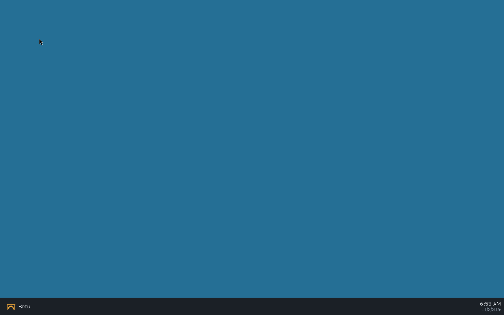

# distro/: bootable Setu image

License: MIT OR Apache-2.0 (the image itself aggregates many packages under
their own licenses).

## Milestone 1: QEMU dev image

A Debian stable (trixie) disk image that boots with UEFI in QEMU, autologs in
the `setu` user and starts a Wayland session: **labwc** (compositor, starts
Xwayland on demand) → **`setu-session`** → the Setu personality (wineserver) →
the shell (`setu-shell.exe` with `--shell`, else Wine's `notepad` as a
placeholder).

All Windows programs share one personality desktop, `setu`: a single
fullscreen Xwayland window sized to the display's preferred mode (read from
`/sys/class/drm`; override with `SETU_RES=WxH`). The personality draws every
window inside it, so labwc never decorates or places them, and the shell's
taskbar and work area apply to all programs. labwc's config
(`rootfs/etc/xdg/labwc/`) turns off server-side decorations, its key
bindings and its root menu.

```sh
distro/build-image.sh     # ~10 min; writes build/distro/setu-dev.qcow2 (~4 GB)
distro/run-qemu.sh        # VNC 127.0.0.1:5911, serial log build/distro/run/serial.log
```

`--help` on either script lists the flags. The useful ones:

* `build-image.sh --wine=debian`: use Debian's wine packages instead of the
  Setu personality build (default `--wine=setu` copies
  `<main checkout>/build/personality/install` to `/opt/setu/personality`).
* `build-image.sh --shell path/to/setu-shell.exe`: install the shell; the
  session then runs it instead of notepad.
* `run-qemu.sh --snapshot`: throw away disk writes.

Login: user `setu`, password `setu` (passwordless sudo; dev image only).
SSH: `ssh -p 2223 setu@127.0.0.1`.

### How it builds without root

The host has no sudo and no `newuidmap`, so `mmdebstrap --mode=unshare` and
other rootless tricks are out. Instead, `build-image.sh` boots a throwaway
KVM **builder VM** (Debian's official `generic` cloud image, checksummed,
configured by a cloud-init seed made with `mkfs.vfat` + `mtools`). Inside it,
`builder/build-rootfs.sh` runs as root: it partitions the output disk (GPT:
ESP + ext4 root), runs `mmdebstrap`, copies the overlay and the personality
(read-only 9p shares), and installs GRUB to the removable EFI path. The VM
then powers off and the raw disk is converted to qcow2. Each build starts
from a fresh builder, so it is repeatable; artifacts live in `build/distro/`.

### Files

| Path | What |
|---|---|
| `build-image.sh` | host-side driver (download, builder VM, output) |
| `builder/build-rootfs.sh` | runs as root in the builder VM |
| `packages.list` | packages in the image (`packages-wine-debian.list` for `--wine=debian`) |
| `rootfs/` | files copied into the image as-is |
| `rootfs/usr/local/bin/setu-session` | the session launcher (personality, desktop size, shell) |
| `rootfs/etc/xdg/labwc/` | labwc config: no decorations, key bindings or root menu |
| `rootfs/etc/systemd/system/setu-session.service` | tty1 autologin running `labwc -S setu-session` |
| `run-qemu.sh` | boots the image (OVMF, virtio-gpu, VNC, serial log, monitor socket) |
| `docs/` | screenshot of the booted session |



Without `--shell` the session runs notepad instead ([screenshot](docs/session.png)).

### Known gaps

* `winedmo.so` (media decoding) links the build host's FFmpeg 6 sonames
  (`libavcodec.so.60`); Debian trixie ships FFmpeg 7, so it doesn't load in
  the image. Everything else in the personality resolves.
* The root filesystem is plain ext4. Casefold for `C:` comes with the
  installer.
* No 3D: QEMU's `virtio-vga` without virgl, so labwc uses the pixman renderer
  and Xwayland falls back to software (glamor off).

## Later (docs/ARCHITECTURE.md §3.5)

* Hybrid UEFI ISO with Secure Boot via shim.
* **Calamares** installer that creates the ext4 **casefold** system volume
  backing `C:` and the first user account.
* First-boot wizard (locale, keyboard, network, user), then
  `setu-system.service` and the shell session.
