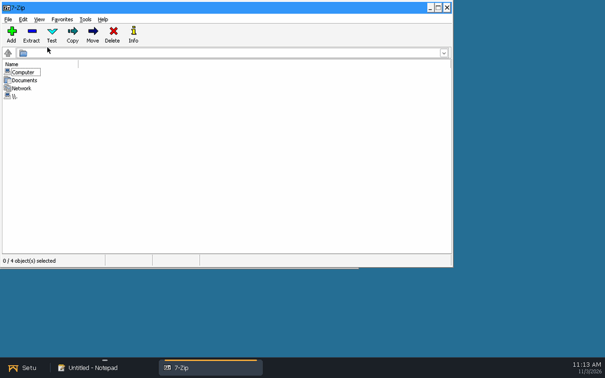
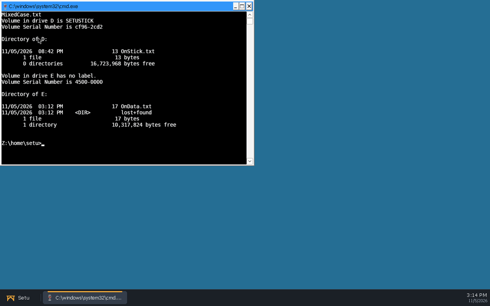
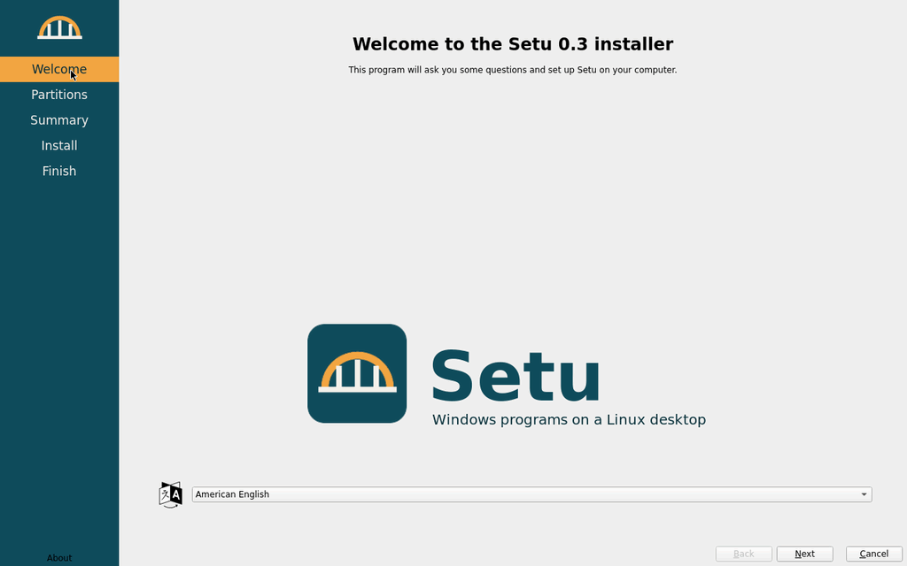
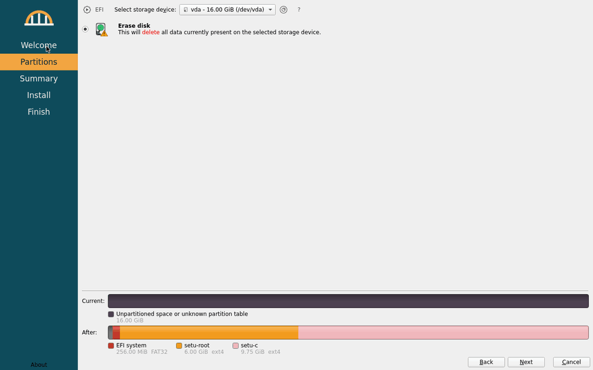
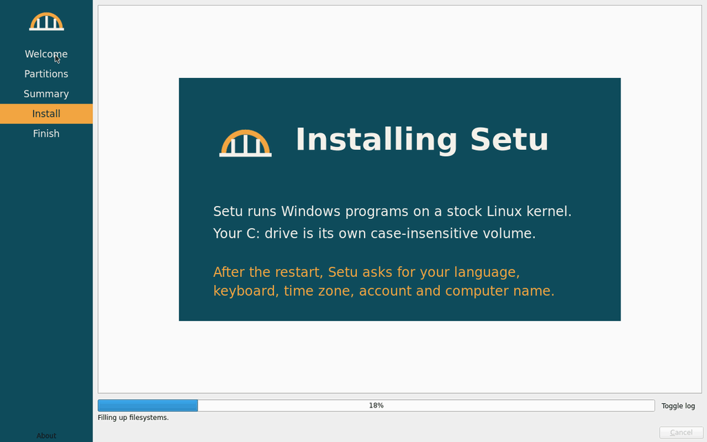
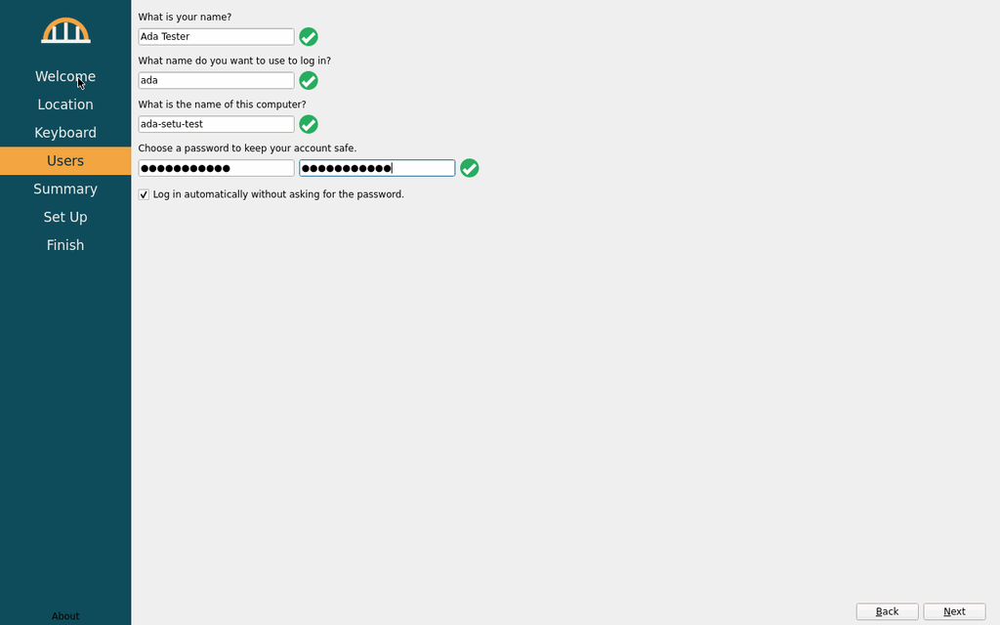

# distro/: bootable Setu image

License: MIT OR Apache-2.0 (the image itself aggregates many packages under
their own licenses).

## Milestone 1: QEMU dev image

A Debian stable (trixie) disk image that boots with UEFI in QEMU, autologs in
the `setu` user and starts a Wayland session: **labwc** (compositor, starts
Xwayland on demand) → **`setu-session`** → the Setu personality (wineserver) →
the shell (`setu-shell.exe` with `--shell`, else Wine's `notepad` as a
placeholder).

All Windows programs share one personality desktop, `setu`: a single
fullscreen Xwayland window sized to the display's preferred mode (read from
`/sys/class/drm`; override with `SETU_RES=WxH`). The personality draws every
window inside it, so labwc never decorates or places them, and the shell's
taskbar and work area apply to all programs. labwc's config
(`rootfs/etc/xdg/labwc/`) turns off server-side decorations, its key
bindings and its root menu.

```sh
distro/build-image.sh     # ~10 min; writes build/distro/setu-dev.qcow2 (~4.5 GB)
distro/run-qemu.sh        # VNC 127.0.0.1:5911, serial log build/distro/run/serial.log
```

`--help` on either script lists the flags. The useful ones:

* `build-image.sh --wine=debian`: use Debian's wine packages instead of the
  Setu personality build (default `--wine=setu` copies
  `<main checkout>/build/personality/install` to `/opt/setu/personality`).
* `build-image.sh --shell path/to/setu-shell.exe`: install the shell; the
  session then runs it instead of notepad.
* `build-image.sh --personality DIR`: the personality install to copy (e.g.
  a worktree's `build/personality/install`).
* `run-qemu.sh --snapshot`: throw away disk writes.
* `run-qemu.sh --run-dir DIR --vnc N --ssh-port N`: run a second VM next to
  the first (own monitor socket, pid file and serial log).

Login: user `setu`, password `setu` (passwordless sudo; dev image only).
SSH: `ssh -p 2230 setu@127.0.0.1`.

### Installing a program: `distro/tests/msi-smoke.sh`

The end-to-end check for "the shell boots in a VM": it boots the image with
`--snapshot` (VNC :21, SSH 2233, run dir `build/distro/msi-smoke/run`), waits
for the session, then over SSH starts Notepad with the shell's run box
(`setu-shell.exe --run`), installs a third-party MSI silently
(`msiexec /i FILE /qn`), starts the installed program the same way, checks
each window appears (`setu-probe.exe windows`), takes a QEMU screendump and
powers the VM off.

```sh
make -C shell                 # setu-shell.exe and setu-probe.exe
distro/build-image.sh --shell build/shell/setu-shell.exe
distro/tests/msi-smoke.sh     # downloads 7-Zip's .msi on first use
```

`--msi FILE --exe 'C:\path\program.exe'` tries another package. The default
is 7-Zip 26.05 x64 (<https://www.7-zip.org/a/7z2605-x64.msi>; GNU LGPL with
BSD-3-Clause parts and the unRAR restriction). It installs into
`C:\Program Files\7-Zip` and 7-Zip File Manager runs on the Setu desktop:



The interactive install (`msiexec /i FILE`, no `/qn`) works too, clicked
through by hand with `setu-probe click`: Welcome, licence, Custom Setup,
Ready, Finish, and the files land in `C:\Program Files\7-Zip`. The wizard
has cosmetic gaps (see below).

### C: and drive letters: `distro/tests/drives-smoke.sh`

The disk has three partitions: the ESP, the Linux root (`setu-root`, 6 GiB
by default, `--root-size`) and **`C:`** (`setu-c`, the rest of `--size`,
12G by default): an ext4 file system made with `-O casefold`, mounted at
`/var/lib/setu/volumes/c`, with `+F` on its root, so the kernel looks names
up without regard to case and keeps their case. The `setu` user's prefix
links its `c:` straight to it. Other volumes get drive letters from the
drive-letter service: the table `/run/setu/dosdevices` (C: fixed, the next
free letter from D: for each volume udev reports), followed by every
session. Details: [services/fs/README.md](../services/fs/README.md).

`drives-smoke.sh` boots a snapshot (VNC :22, SSH 2234, run dir
`build/distro/drives-smoke/run`) and checks: `lsattr -d` shows the casefold
flag on the volume behind C:; `C:\Test\MixedCase.txt` made with cmd is found
as `c:\test\mixedcase.TXT` and listed as `MixedCase.txt`; a FAT USB stick
plugged in through the QEMU monitor (`drive_add` + `device_add
usb-storage`) becomes `D:` (GetLogicalDrives, GetDriveType,
GetVolumeInformation, `dir D:`), a second disk `E:`, and unplugging
(`device_del`) removes the letter again. The disk images are made on the
host without root (`mkfs.vfat -C` + `mcopy`, `mkfs.ext4 -d`). Then it runs
`msi-smoke.sh`.

```sh
make -C shell
distro/build-image.sh --shell build/shell/setu-shell.exe
distro/tests/drives-smoke.sh      # [--msi FILE] [--no-msi]
```



### How it builds without root

The host has no sudo and no `newuidmap`, so `mmdebstrap --mode=unshare` and
other rootless tricks are out. Instead, `build-image.sh` boots a throwaway
KVM **builder VM** (Debian's official `generic` cloud image, checksummed,
configured by a cloud-init seed made with `mkfs.vfat` + `mtools`). Inside it,
`builder/build-rootfs.sh` runs as root: it partitions the output disk (GPT:
ESP + ext4 root), runs `mmdebstrap`, copies the overlay and the personality
(read-only 9p shares), and installs GRUB to the removable EFI path. The VM
then powers off and the raw disk is converted to qcow2. Each build starts
from a fresh builder, so it is repeatable; artifacts live in `build/distro/`.
`build-iso.sh` (`build-image.sh --kind iso`) uses the same builder: the root
file system goes to a directory instead of a partition, and the ISO image is
written to the raw output disk, which the host truncates to its size.

### Files

| Path | What |
|---|---|
| `build-image.sh` | host-side driver (download, builder VM, output); `--kind iso` for the installer |
| `build-iso.sh` | `build-image.sh --kind iso`: `build/distro/setu-installer.iso` |
| `builder/build-rootfs.sh` | runs as root in the builder VM (disk image or ISO) |
| `layout.env` | the disk layout (ESP, root, C: sizes, names, labels, GPT types), read by the builder and the installer |
| `rootfs/usr/lib/setu/setu-cvol-init` | makes an ext4 volume into C: (casefold, label, `lost+found` hidden); used by both |
| `installer/` | the ISO's extra packages, GRUB menu, Calamares config and branding, first-boot wizard |
| `installer/make-artwork.sh` | regenerates the branding PNGs (ImageMagick) |
| `packages.list` | packages in the image (`packages-wine-debian.list` for `--wine=debian`) |
| `rootfs/` | files copied into the image as-is |
| `rootfs/usr/local/bin/setu-session` | the session launcher (personality, desktop size, shell) |
| `rootfs/etc/xdg/labwc/` | labwc config: no decorations, key bindings or root menu |
| `rootfs/etc/systemd/system/setu-session.service` | tty1 autologin running `labwc -S setu-session` |
| `../services/fs/` | drive-letter service and its units, installed by `build-image.sh` |
| `run-qemu.sh` | boots the image (OVMF, virtio-gpu, VNC, serial log, monitor socket) |
| `tests/msi-smoke.sh` | boots a snapshot, installs and runs an .msi over SSH, screendump |
| `tests/drives-smoke.sh` | casefold C: and drive-letter hot-plug checks, then `msi-smoke.sh` |
| `tests/install-smoke.sh` | installs from the ISO on a blank disk, runs the first-boot wizard, checks the result |
| `tests/install-answers.conf` | test-only account and expected locale for `install-smoke.sh` |
| `tests/lib.sh` | helpers shared by the smoke tests (boot, SSH, wine in the session, screendump, keys) |
| `docs/` | screenshots of the booted session |


Without `--shell` the session runs notepad instead ([screenshot](docs/session.png)).

### Known gaps

* `winedmo.so` (media decoding) links the build host's FFmpeg 6 sonames
  (`libavcodec.so.60`); Debian trixie ships FFmpeg 7, so it doesn't load in
  the image. Everything else in the personality resolves.
* The Linux root file system is plain ext4; only `C:` is casefolded. The
  installer makes the same layout (`layout.env`).
* MSI wizard UI (7-Zip's): the Custom Setup page shows the dialog's
  placeholder text ("Neque porro quisquam...") instead of the selected
  feature's description and the install location, the Welcome/Finish pages
  have no banner bitmap, and the licence checkbox is already ticked on first
  view. Not yet compared with Windows on the oracle.
* No 3D: QEMU's `virtio-vga` without virgl, so labwc uses the pixman renderer
  and Xwayland falls back to software (glamor off).

## Milestone 3: installer ISO and first-boot wizard

```sh
make -C shell
distro/build-iso.sh --shell build/shell/setu-shell.exe   # build/distro/setu-installer.iso
distro/tests/install-smoke.sh                            # install it in QEMU, end to end
```

`build/distro/setu-installer.iso` is a hybrid UEFI image (it boots from a
CD or, written with `dd`, from a USB stick). It starts a Debian live system
whose only program is the **Calamares** installer (Debian's package, GPL-3)
with Setu branding (`installer/rootfs/usr/share/calamares/branding/setu/`,
our own artwork from `installer/make-artwork.sh`: text and plain shapes).

### How the ISO is built

`build-iso.sh` is `build-image.sh --kind iso`: the same rootless builder VM
and the same root file system as the dev image (`packages.list`, `rootfs/`,
`services/fs`, the personality, the shell) plus `installer/` (its
`packages.list` and `rootfs/`). Instead of partitioning a disk,
`builder/build-rootfs.sh` builds into a directory, squashes it
(`live/filesystem.squashfs`, xz) and runs `grub-mkrescue`, which writes an
ISO with an El Torito EFI image, an appended EFI partition and a protective
MBR (that is what makes it hybrid). The builder writes the ISO to the start
of its output disk; the host cuts the raw disk to the ISO's size.

Why our own squashfs + `grub-mkrescue` instead of live-build: the builder
already makes the root file system with mmdebstrap, so the live system *is*
the system the installer copies, with no second build recipe. live-build
would rebuild it its own way (and needs root on the host or its own VM all
the same). The pieces we need from Debian Live are just `live-boot` (finds
the squashfs on the medium and overlays a tmpfs) and Calamares.

### The installer

`setu-live-installer.service` (only with `boot=live` on the kernel command
line) runs labwc on tty1 with Calamares as root. Calamares
(`installer/rootfs/etc/calamares/`) asks one question, which disk to erase
(Welcome, Partitions, Summary), then:

| Job | What |
|---|---|
| `partition` | GPT: ESP, `setu-root`, `setu-c` (the rest, ext4 with `casefold`) |
| `mount` | the new partitions under Calamares' root mount point |
| `shellprocess@cvol` | `setu-install cvol`: `setu-cvol-init` on the C: volume (casefold flag, label, hidden `lost+found`) |
| `unpackfs` | the live squashfs onto the new root |
| `machineid`, `fstab` | a new machine id; fstab with all three partitions |
| `packages` | removes `live-boot` (offline) |
| `shellprocess@target` | `setu-install target`: puts the first-boot wizard's config in `/etc/calamares` |
| `initramfs`, `bootloader` | initramfs without live-boot; GRUB on the ESP (NVRAM entry "Setu" + removable path) |

The layout has one source of truth, **`layout.env`**: `build-rootfs.sh`
partitions the dev image with it and turns it into Calamares'
`partition.conf` (`installer/partition.conf.in`). Making a volume into C:
(`rootfs/usr/lib/setu/setu-cvol-init`) is shared too. The live system keeps
`setu-drives` and `setu-volume@` off (drop-ins), so they don't mount the
disk being partitioned.

Language, keyboard, time zone, the account and the computer name are *not*
asked by the installer: the installed system asks them once, on its first
boot, so there's one place for them (the OEM pattern: the installer can be
run by someone other than the user).

### The first-boot wizard: Calamares in OEM mode

On the installed system `setu-firstboot.service` runs before the session
(only while `/var/lib/setu/firstboot.done` doesn't exist): labwc + Calamares
with `/etc/calamares` = `installer/rootfs/usr/share/setu/firstboot/calamares/`
(`dont-chroot: true`, `oem-setup: true`, no Cancel). Pages: Welcome
(language), Location (time zone, system locale), Keyboard, Users (full name,
login name, computer name, password; the account goes in `sudo`, root stays
locked), Summary, **Set Up**. Its jobs are Calamares' own `locale`,
`keyboard`, `localecfg` and `users`, then `setu-firstboot-finish USER`:
`setu-session.service` gets `User=USER` and the chosen XKB layout
(drop-ins), C: is chowned to USER, `firstboot.done` is created, the wizard's
unit disabled and its config removed, and the session enabled and started.

Why Calamares and not a program of our own: it is already on the medium
(the live system and the installed system are one squashfs), its users,
locale and keyboard modules are the tested code for exactly these files
(`useradd`, sudoers, `/etc/hostname`, `/etc/default/locale`, `locale-gen`,
`/etc/localtime`, `/etc/default/keyboard`), it is translated, and it looks
like the installer the user just saw. OEM mode (`dont-chroot`) is a
documented Calamares setup for this. The cost is Qt and parts of KDE
Frameworks staying in the installed system, which a small dedicated
program would avoid. If Calamares quits before the wizard is done,
`setu-firstboot-session` starts it again.

### `distro/tests/install-smoke.sh`

QEMU (4 GB, q35, OVMF), a blank 16 GB qcow2 and the ISO as a CD-ROM
(VNC :24, SSH 2236, run dir `build/distro/install-smoke/run`). The test
drives Calamares through the keyboard, as a user would (QEMU `sendkey`:
the buttons' Alt shortcuts, Tab between fields): Calamares has no
unattended mode, and a test-only config would not test the real one. It
waits for the end of each phase in the serial log (the units and
`setu-install`/`setu-firstboot-finish` log there), types the account from
the test-only answers file `tests/install-answers.conf`, then checks over
SSH as that account: the session's taskbar, hostname/locale/time
zone/keyboard/groups/sudo, C: on the `setu-c` partition with the casefold
flag (a file made by cmd found in another case), setu-ntacld (a DACL set
from Windows lands in `security.NTACL` and is enforced), the wizard unit
disabled and `live-boot` gone; then it reboots and checks the session comes
back without the wizard. Screendumps of each stage: `docs/install-*.png`.
The scratch disk and UEFI variables are deleted at the end.










The other stages: [summary](docs/install-summary.png),
[finished](docs/install-finished.png), first boot
[welcome](docs/install-firstboot-welcome.png),
[location](docs/install-firstboot-locale.png),
[keyboard](docs/install-firstboot-keyboard.png),
[summary](docs/install-firstboot-summary.png).

### Known gaps (installer)

* UEFI only (no BIOS boot), no Secure Boot.
* The wizard's "Log in automatically" checkbox has no effect: the Setu
  session always logs the account in on tty1, as the dev image does.
* `ssh` is enabled on the installed system, as in the dev image (the tests
  use it); a release build would leave it off.
* Calamares pulls in Qt 6 and parts of KDE Frameworks (part of the
  2.5 GB root file system) and stays installed, because the first-boot
  wizard is Calamares too.
* The installer erases a whole disk; there is no manual partitioning, no
  install alongside another system and no encryption.

## Later (docs/ARCHITECTURE.md §3.5)

* Secure Boot via shim (the ISO and the installed system use plain GRUB).
* Network setup in the first-boot wizard (systemd-networkd does DHCP on
  every wired interface; no Wi-Fi yet).
* `setu-system.service` instead of starting the session directly.
