# Default apps

The Setu image (`distro/build-image.sh`) and the installer ISO come with
these Windows programs installed in `C:\Program Files`, with Start menu
shortcuts and a default app for each common file type. The list is the
owner's decision (2026-11-08): 14 apps and Wine's own accessories, nothing
else. A new app needs the owner's approval first. 13 of the 14 are in the
image; Windows Terminal is left out until it runs
([Known issues](#known-issues)).

The pins live in [`distro/apps/apps.toml`](../distro/apps/apps.toml): for
each app the version, the official download URL, its SHA-256 and size,
where that checksum was checked against the vendor's own, the licence, the
source code of that release, the silent install arguments and what the
smoke test looks for.

| App | Version | Kind | Install folder | Licence |
|---|---|---|---|---|
| Mozilla Firefox | 159.0.1 | Mozilla NSIS, `/S` | `C:\Program Files\Mozilla Firefox` | MPL-2.0 |
| LibreOffice | 26.8.2 | MSI | `C:\Program Files\LibreOffice` | MPL-2.0 (parts LGPL-3.0-or-later) |
| SumatraPDF | 3.6.1 | own installer, `-install -silent -all-users` | `C:\Program Files\SumatraPDF` | GPL-3.0 (parts BSD) |
| Notepad++ | 8.9.9 | NSIS, `/S` | `C:\Program Files\Notepad++` | GPL-3.0-or-later |
| 7-Zip | 26.06 | MSI | `C:\Program Files\7-Zip` | LGPL-2.1-or-later (parts BSD; unRAR restriction) |
| ImageGlass | 10.0.6.906 | MSI | `C:\Program Files\ImageGlass` | GPL-3.0 |
| GIMP | 3.2.8 | Inno Setup | `C:\Program Files\GIMP 3` | GPL-3.0-or-later |
| Inkscape | 1.4.4 | MSI | `C:\Program Files\Inkscape` | GPL-2.0-or-later |
| VLC media player | 3.0.24 | NSIS, `/L=1033 /S` | `C:\Program Files\VideoLAN\VLC` | GPL-2.0-or-later (libVLC LGPL-2.1-or-later) |
| KeePassXC | 2.8.0 | MSI | `C:\Program Files\KeePassXC` | GPL-3.0-or-later |
| PuTTY | 0.85 | MSI | `C:\Program Files\PuTTY` | MIT |
| WinSCP | 6.7 | Inno Setup | `C:\Program Files (x86)\WinSCP` | GPL-3.0-or-later |
| ShareX | 22.4.0 | Inno Setup | `C:\Program Files\ShareX` | GPL-3.0-or-later |

All are the vendors' 64-bit builds except WinSCP, which is 32-bit only.

Wine's accessories get Start menu shortcuts with Setu icons
(`distro/apps/icons.py`): **WordPad** and **Clock**. Notepad is already in
the Start menu (setu-shell's built-in entry). Wine has no calculator and no
paint program, so the image has neither; the owner listed them "if useful",
and there is nothing to add without a new app.

## How it works

Installing at image build time, so that the first boot is instant, has a
catch: the installers are Windows programs, and the image is built by
mmdebstrap in a builder VM that has no display and no Wine session. Three
ways were weighed:

1. Run the installers in the builder VM: it would need Xvfb, the
   personality and a prefix there, and an install failure would be hard to
   see from outside the VM.
2. Run them at first boot or first login: simple, but the first login
   would take minutes and need the downloads in the image.
3. **Run them on the build host, then copy the result in** (chosen). The
   host already has the personality build and Xvfb; the result is a plain
   folder plus a registry file, cached between builds.

The steps:

* `distro/apps/fetch.py` downloads each installer into
  `build/distro/downloads/apps` (never committed) and checks its size and
  SHA-256 against the pin. A download that doesn't match is an error.
* `distro/apps/stage.py` (run by `build-image.sh`) creates a throwaway
  prefix whose `C:` is a staging folder, under its own Xvfb (never the
  host display) and in a user and UTS namespace whose host name is
  `setu`, as user `setu`, so nothing in the result names the build host.
  It runs each installer with the vendor's documented silent arguments
  (`msiexec /i FILE /qn ALLUSERS=1 ...` for MSIs). Zip apps are unpacked.
  Then it keeps:
  * the files the installs added or changed under `Program Files`,
    `Program Files (x86)`, `ProgramData` (shortcuts in the common Start
    menu) and `windows\Installer` (the MSI packages that Windows Installer
    keeps for repair and uninstall, and shortcut icons), in
    `build/distro/apps-stage/c`. Files outside those folders (fonts and
    Visual C++ runtime DLLs some installers drop into `windows`, desktop
    shortcuts, the build user's profile) are left out: the personality
    provides its own runtime, and the desktop stays empty;
  * what the installs added to `HKEY_LOCAL_MACHINE\Software` (file types,
    ProgIDs, App Paths, Uninstall entries, the apps' own settings), read
    from Wine's `system.reg` before and after, plus Setu's default app per
    file type ([below](#file-associations)), as a regedit file,
    `apps.reg`;
  * `report.json` (per app: exit code, time, files, size) and
    `LICENSES.txt`.
  The result is cached: `stamp` hashes apps.toml, the staging scripts, the
  personality build and the app list, and a later build with the same
  inputs reuses it (`--force` redoes it).
* `build-image.sh` shares `apps-stage/c` with the builder VM, which copies
  it onto the C: volume (`/var/lib/setu/volumes/c`) and puts `apps.reg`,
  `report.json` and `LICENSES.txt` in `/usr/share/setu/apps`. In the ISO
  the folder is part of the live tree; the installer copies it onto the
  target's C: volume with everything else.
* Every user's prefix has its own registry, while C: is shared. So
  `setu-apps-register` imports `apps.reg` into the prefix with
  `regedit /S`, once per version of the file (its SHA-256 is kept in
  `$WINEPREFIX/.setu-apps.stamp`). The image build runs it for the dev
  image's user, and `setu-session` runs it at every login, so new users
  and updated images get the entries too. A user's own choices under
  `HKEY_CURRENT_USER\Software\Classes` still win.

`build-image.sh --no-apps` leaves all of this out (and `--wine=debian`
implies it).

### Start menu

The MSI installers ask for per-machine shortcuts (`ALLUSERS=1`), but
Wine's msi puts them in the installing user's Programs folder
(`dlls/msi/package.c` resolves `ProgramMenuFolder` per user; reported to
the shell-api team). `stage.py` moves them to the common Programs folder
(`C:\ProgramData\Microsoft\Windows\Start Menu\Programs`), where Windows
puts them. An app with `start_menu = false` in apps.toml stays installed
but gets no Start menu shortcuts (now ImageGlass, which does not start
yet); `apps-smoke.sh` checks that none are there. Startup shortcuts are dropped (ShareX makes one): no default
app starts by itself at login. Zip apps (none at the moment) and the Wine
accessories get shortcuts from `distro/apps/setu-mklnk.c`.

setu-shell lists both Programs folders; a folder with a single shortcut
shows as that shortcut.

## File associations

`[associations]` in apps.toml picks one app per file type. Each installer
claims some types, and several claim the same ones; without a choice the
last installer would win. For each type, `stage.py` points
`HKLM\Software\Classes\<ext>` at the ProgID that app's own installer
registered (its default, OpenWithProgids or Default Programs
Capabilities). Where the app registered none, it writes a `Setu.<App>`
ProgID that opens the file with the app's exe. The other apps stay in
"Open with".

| Types | Default | Also registered by |
|---|---|---|
| .pdf | SumatraPDF | LibreOffice (Draw), GIMP |
| .epub .xps .oxps .djvu .cbz .cbr .mobi .fb2 | SumatraPDF | |
| .odt .ods .odp .odg .doc .docx .xls .xlsx .ppt .pptx .rtf .csv | LibreOffice | (.rtf: WordPad in Wine's defaults) |
| .txt .log .ini .xml .json .md .yaml .yml | Notepad++ | LibreOffice (.txt .xml), Wine's Notepad |
| .htm .html .xhtml, http and https links | Firefox | LibreOffice (.htm .html), Wine's built-in browser |
| .png .jpg .jpeg .gif .bmp .webp .tif .tiff | SumatraPDF | ImageGlass, GIMP, LibreOffice |
| .ico .avif | ImageGlass | GIMP, LibreOffice |
| .svg | Inkscape | GIMP, LibreOffice |
| .xcf | GIMP | |
| .mp4 .mkv .avi .mov .webm .wmv .mp3 .ogg .flac .wav .m4a .opus | VLC | |
| .zip | compressed folder (`CompressedFolder`, opens in setu-files) | 7-Zip (Open with only) |
| .7z .rar .tar .gz .tgz .bz2 .xz .zst | compressed folder (`ArchiveFolder`, opens in setu-files) | 7-Zip (Open with only) |
| .kdbx | KeePassXC | |

Conflicts decided:

* **PDF**: SumatraPDF, the light viewer, over LibreOffice Draw (an
  editor) and GIMP (imports one page as an image).
* **Images**: SumatraPDF for .png .jpg .jpeg .gif .bmp .webp .tif .tiff
  (owner, 2026-11-09), since ImageGlass, the image viewer, does not start
  yet; GIMP is an editor. .ico and .avif, which SumatraPDF does not open,
  stay with ImageGlass for now. SVG
  goes to Inkscape, the vector editor.
* **Plain text**: Notepad++ over Wine's Notepad and LibreOffice.
* **RTF**: LibreOffice Writer over WordPad: it keeps more formatting.
* **HTML**: Firefox over LibreOffice Writer/Web.
* **Archives**: compressed folders, as on Windows 11 (owner, 2026-11-09):
  the personality's zipfldr registers `CompressedFolder` for .zip and
  `ArchiveFolder` for the other archive types, and setu-files browses
  them. 7-Zip is listed in `[open_with]` in apps.toml: `stage.py` only
  adds its ProgID (`Setu.7Zip`) to each type's `OpenWithProgids` and drops
  any default an installer set, so the system's stays.

  Known differences from Windows 11 that stay as they are (owner,
  "Agreed on archives", 2026-11-09; oracle tests
  shell32/compressed_formats and shell32/compressed_folders):
  1. `ITransferSource::OpenItem` on an entry of a 7z, rar, cpio or
     compressed tar returns S_OK with a stream in Setu; Windows returns
     S_FALSE without one. Left as it is.
  2. `IFileOperation::CopyItem` is implemented (it was a stub) and copies
     entries out of compressed folders, as on Windows. Kept.
  3. .xar is registered as an `ArchiveFolder`, as on Windows, but the
     zipfldr's libarchive reader (arclib.c) does not enable the xar
     format (it needs an XML parser), so Setu can't list a .xar's
     entries. Left unreadable for now.
  4. The RAR support is tested with a RAR5 archive only; a RAR4 case is
     to be added to shell32/compressed_formats later.
  5. Minor .cab differences: Windows' data object also lists
     `OleClipboardPersistOnFlush` and a private format, and its
     `IFileOperation` copy out of a cab is aborted, where Setu's
     succeeds. Left as they are.

## Licences and source

Every app is the vendor's official release, installed unmodified. Its
licence text is in its install folder; NOTICE section 7 and
`/usr/share/setu/apps/LICENSES.txt` in the image list each app's licence
and the source code of exactly the release Setu ships:

| App | Source of this release |
|---|---|
| Firefox | <https://ftp.mozilla.org/pub/firefox/releases/159.0.1/source/> |
| LibreOffice | <https://download.documentfoundation.org/libreoffice/src/26.8.2/> |
| SumatraPDF | <https://github.com/sumatrapdfreader/sumatrapdf/archive/refs/tags/3.6.1rel.tar.gz> |
| Notepad++ | <https://github.com/notepad-plus-plus/notepad-plus-plus/archive/refs/tags/v8.9.9.tar.gz> |
| 7-Zip | <https://github.com/ip7z/7zip/releases/download/26.06/7z2606-src.tar.xz> |
| ImageGlass | <https://github.com/d2phap/ImageGlass/archive/refs/tags/10.0.6.906.tar.gz> |
| GIMP | <https://download.gimp.org/gimp/v3.2/gimp-3.2.8.tar.xz> |
| Inkscape | <https://inkscape.org/release/inkscape-1.4.4/source/> |
| VLC | <https://download.videolan.org/pub/videolan/vlc/3.0.24/vlc-3.0.24.tar.xz> |
| KeePassXC | <https://github.com/keepassxreboot/keepassxc/releases/download/2.8.0/keepassxc-2.8.0-src.tar.xz> |
| PuTTY | <https://the.earth.li/~sgtatham/putty/0.85/putty-0.85.tar.gz> |
| WinSCP | <https://github.com/winscp/winscp/archive/refs/tags/6.7.tar.gz> |
| ShareX | <https://github.com/ShareX/ShareX/archive/refs/tags/v22.4.0.tar.gz> |

The GPL and LGPL apps are distributed in binary form, so their source must
stay available for as long as Setu ships those binaries. The links above
are the projects' own archives of the exact releases. If the project
mirrors them itself later (owner decision), this table and NOTICE are
where to point.

### Release checklist

- [ ] mirror the corresponding GPL/LGPL sources for each shipped app at public release time

Owner decision 2026-11-09: until then Setu links the upstream archives
above. The mirror holds the exact releases in apps.toml, on a host the
project controls; this table, NOTICE section 7 and `LICENSES.txt`
(written by `distro/apps/stage.py`) then point at it.

## Updating a pin

1. Find the new release on the app's official page (`homepage` in
   apps.toml). Use the 64-bit Windows build of the same kind (MSI stays
   MSI, and so on).
2. Change `version` and `url`, then run
   `distro/apps/fetch.py --pin -a ID`: it downloads the file and prints the
   `sha256` and `size` lines to paste in. Check the SHA-256 against the
   vendor's own published checksum (`checksum_src`); if the vendor
   publishes none, write `""` there.
3. Update `source_url` (and `licence` if it changed), NOTICE section 7 and
   the tables in this file.
4. Check the silent arguments and the `exe` path still hold, then
   rebuild: `distro/build-image.sh` restages the apps because apps.toml
   changed. `build/distro/apps-stage-logs/` has each installer's log.
5. Run `distro/tests/apps-smoke.sh --update-docs` and commit the new
   screenshots with the pin.

## Size

Measured 2026-11-08 (the "without" figures are estimates: the with-apps
build minus the apps).

| | Without apps | With apps | Growth |
|---|---|---|---|
| C: contents (staged apps) | - | 4.0 GiB | +4.0 GiB |
| Dev image (qcow2, allocated) | ~4.8 GiB | 8.9 GiB | +4.1 GiB |
| Installer ISO (xz squashfs) | ~0.9 GiB | 2.5 GiB (2544 MiB) | +1.6 GiB |

The ISO's squashfs stays well under 4 GiB, so `grub-mkrescue` needs no
ISO level 3. The ISO's root file system is 7.1 GiB before compression;
the apps squash to 1.6 GiB with xz.

The apps take 4.0 GiB on C:: 3.4 GiB of programs (LibreOffice 1.1 GiB,
Inkscape 0.8, GIMP 0.6, ShareX 0.5, Firefox 0.35) and 0.6 GiB of MSI
packages that Windows Installer keeps in `C:\windows\Installer` for repair
and uninstall. So the dev image's default disk is 20G (12G with
`--no-apps`), and the installer asks for at least 16 GiB.

## Smoke test: `distro/tests/apps-smoke.sh`

Boots an image in QEMU (`--build` builds one first) and checks over ssh:
the prefix imported apps.reg, the default app for some file types, the
Start menu shortcuts, and for each app that its exe exists and that it
shows a window within the timeout (`setu-probe windows`, matched against
the `window` pattern in apps.toml). It saves a screendump per app.
Apps with a `known_issue` are reported but don't fail the run.
`--update-docs` refreshes the screenshots below.

```sh
distro/tests/apps-smoke.sh --build --vnc 26 --ssh-port 2246 --update-docs
```

## Results

`apps-smoke.sh` on the dev image, 2026-11-09 (QEMU, 3 GB, 1280x800,
personality at main's build plus ICU and winscard). "Window" is the first matching
top-level window and how long after the start it appeared.

| App | Installed | Window | Notes |
|---|---|---|---|
| Firefox 159.0.1 | yes | **no** | crashes at start (access violation), also on the retry; new since 2026-11-08 and also without ICU, so a regression in the merged personality ([Known issues](#known-issues)) |
| LibreOffice 26.8.2 | yes | yes, 17 s | Writer with sample.txt |
| SumatraPDF 3.6.1 | yes | yes, 4 s | sample.pdf |
| Notepad++ 8.9.9 | yes | yes, 7 s | sample.txt |
| 7-Zip 26.06 | yes | yes, 4 s | File Manager in `C:\setu-apps` |
| ImageGlass 10.0.6.906 | yes, not in the Start menu | **no** | "Unhandled exception" dialog (known issue) |
| GIMP 3.2.8 | yes | yes, 270 s | first start builds its font and plug-in caches |
| Inkscape 1.4.4 | yes | yes, 20 s | sample.svg |
| VLC 3.0.24 | yes | yes, 4 s | |
| KeePassXC 2.8.0 | yes | yes, 2 s | welcome screen, with a warning bar about screenshot blocking ([Known issues](#known-issues)) |
| PuTTY 0.85 | yes | yes, <1 s | PuTTY Configuration |
| WinSCP 6.7 | yes | yes, 6 s | Login dialog |
| ShareX 22.4.0 | yes | **no** | exits at start: its single-instance wait fails, new since 2026-11-08 and also without ICU ([Known issues](#known-issues)) |
| WordPad (Wine) | built in | yes, 1 s | |
| Clock (Wine) | built in | yes, 1 s | |
| Windows Terminal 1.25.2733.0 | **left out** | - | gets past ICU; needs the system XAML framework |

The test also checks that the prefix imported apps.reg; that .pdf .txt
.png .jpg .tif .html .docx .mp4 .svg and .kdbx open with their default
app (.png .jpg and .tif with SumatraPDF); that .zip is a `CompressedFolder` and .7z
an `ArchiveFolder`, both opening in setu-files, with 7-Zip in their "Open
with" list; that the common Programs folder has the shortcuts (36); and
that ImageGlass has none.

| | | |
|---|---|---|
| 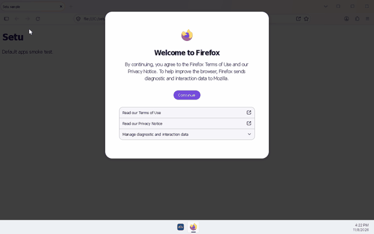 Firefox (no window) | 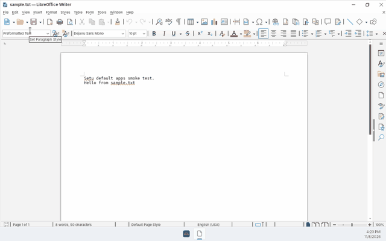 LibreOffice | 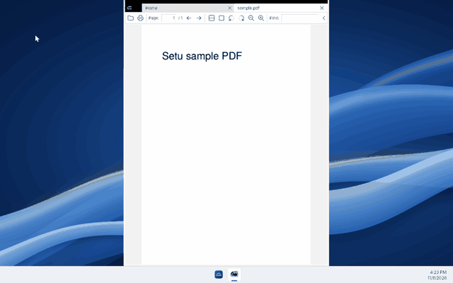 SumatraPDF |
| 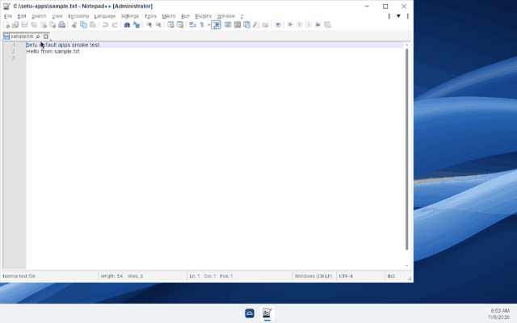 Notepad++ | 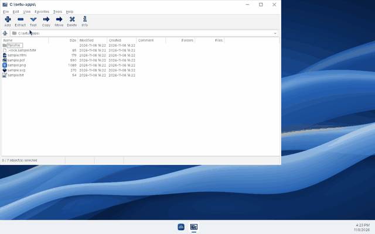 7-Zip | 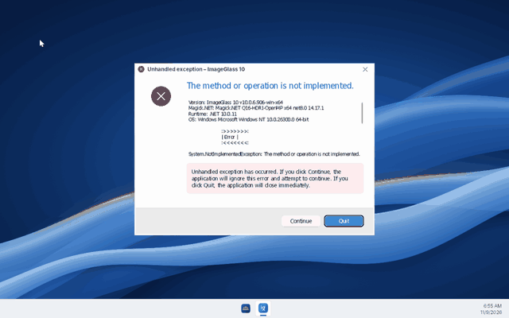 ImageGlass (error) |
| 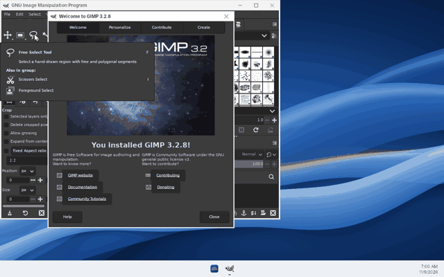 GIMP | 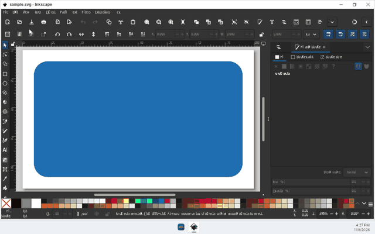 Inkscape | 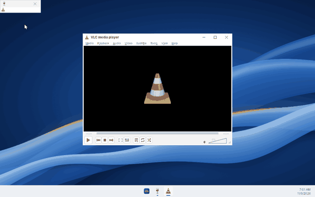 VLC |
| 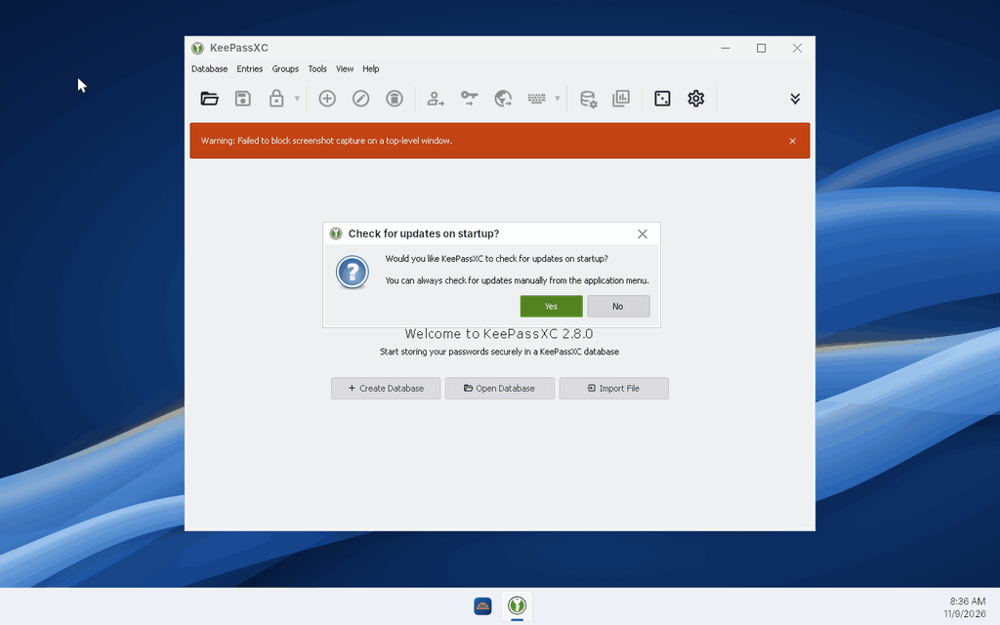 KeePassXC | 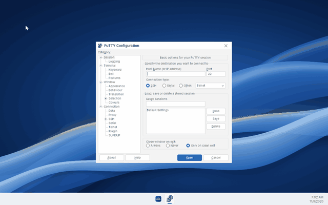 PuTTY | 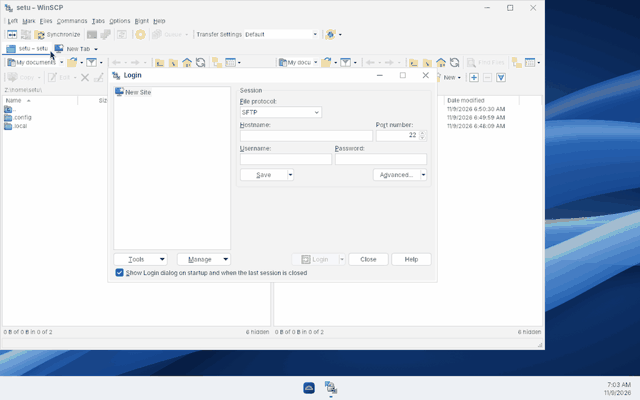 WinSCP |
| 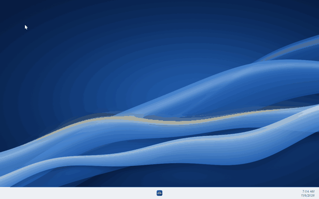 ShareX (no window) | 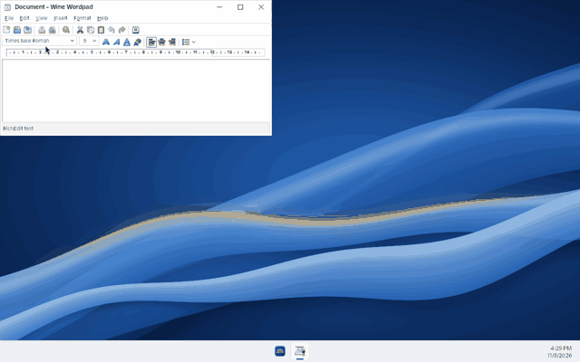 WordPad | 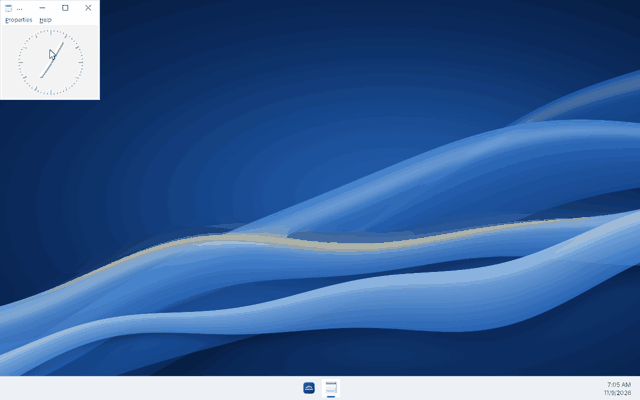 Clock |

## Known issues

* **Windows Terminal** 1.25.2733.0 (the portable zip) is left out: it
  does not start. The personality now has ICU (`icu.dll`,
  tools/icu/README.md), which `TerminalApp.dll` imports, so it gets
  further: `TerminalApp.dll` loads, but its initialisation fails because
  it needs the system XAML framework (`Windows.UI.Xaml`, the class
  `Windows.UI.Xaml.DurationHelper`), which the personality does not have,
  and `WindowsTerminal.exe` then crashes. Its pin stays in apps.toml,
  commented out.
* **KeePassXC** starts and is in the Start menu again: it imports
  `icuuc.dll` (Qt6Core), which the personality's ICU provides, and
  `WinSCard.dll`, which the personality now builds against libpcsclite
  (tools/personality-build-deps.txt, or the toolchain's copy without root;
  `libpcsclite1` in distro/packages.list). It shows a warning bar, "Failed
  to block screenshot capture on a top-level window": the personality does
  not implement `SetWindowDisplayAffinity`'s capture exclusion.
* **ImageGlass** starts with an "Unhandled exception" dialog
  (`System.NotImplementedException`) instead of its viewer; the log points
  at `Windows.Storage.ApplicationData` and `Windows.UI.Composition`, which
  the personality implements only in part. Reported to shell-api. It stays
  installed but is hidden from the Start menu, and the common image types
  open in SumatraPDF; .ico and .avif still point at it.
* **Firefox**: its first start after login crashes (an access violation
  within two seconds, no window); clicking it again works, and so does
  every later start. Its log also shows sandboxed child processes failing
  to start (`c0000022`), though pages load. Both reported to shell-api.
  The smoke test starts an app a second time when the first start exits
  without a window, and says so. Since the 2026-11-09 merge of main the
  second start crashes too (the same access violation at a small address,
  with or without ICU, in the VM and under Xvfb): a regression in the
  personality, not yet bisected.
* **ShareX** exits at start since the 2026-11-09 merge of main, also with
  ICU disabled: its log (`Documents\ShareX\Logs`) shows it taking itself
  for a second instance. The trace shows the wait on its single-instance
  mutex returning `STATUS_USER_APC` after a special user APC
  (`call_user_apc_dispatcher flags 0x3 are not supported`); the likely
  cause is "kernel32: Export QueueUserAPC2", which lets .NET use special
  APCs that the personality does not deliver properly.
* **WinSCP** used to show no window under Setu (docs/COMPAT.md); it now
  shows its Login dialog.
* **Wine's msi** puts `ALLUSERS=1` shortcuts in the per-user Programs
  folder; stage.py works around it (see [Start menu](#start-menu)).
* **No calculator, no paint program**: Wine has neither.
* The MSI packages kept in `C:\windows\Installer` take 0.6 GiB. Dropping
  them would break repair and uninstall from Apps & features, so they
  stay.
