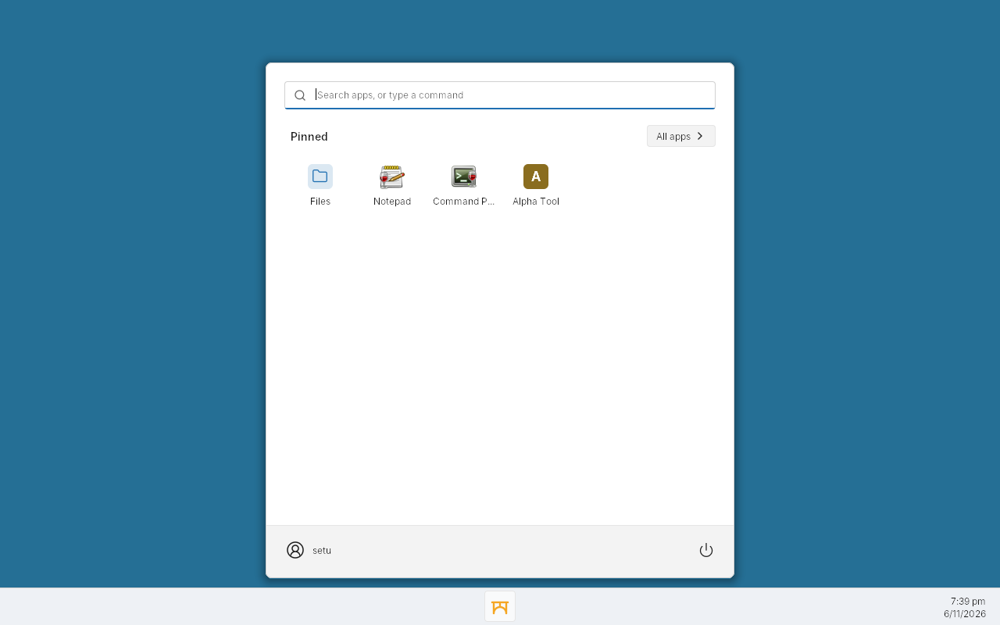

# shell/: Setu desktop shell

License: MIT OR Apache-2.0. **Status: Milestone 3 taskbar + start menu.**

The shell is a plain **Win32 application** (mingw-w64, C) that runs on the
Setu personality. It only uses public, documented APIs from user32, gdi32,
shell32, ole32, advapi32 and kernel32, so it doubles as a test of the
personality (docs/ARCHITECTURE.md §3.4).



## What it does

- **Taskbar** docked to the bottom of the primary monitor. It registers as an
  appbar (`SHAppBarMessage`) and reserves the work area
  (`SPI_SETWORKAREA`) when the appbar alone doesn't.
- **Start menu** (start button, the Windows key on its own, or Ctrl+Esc):
  - **All apps**, A to Z under letter headers: the built-ins (Files =
    `setu-files.exe`, else `explorer.exe`/`winefile.exe`; Notepad, Command
    Prompt, Registry Editor) plus every `.lnk` and `.url` under the per-user
    and common Start Menu *Programs* folders and their subfolders
    (`SHGetFolderPathW`, `IShellLinkW`, names from `SHGetFileInfoW`). A link
    in both folders is listed once (the per-user one wins). A folder with
    several apps is a group you can expand (nested folders are folded into
    it); a folder with one app just shows the app. `.appref-ms` (ClickOnce)
    isn't listed: its format isn't publicly documented.
  - **Other apps**: programs in the `Uninstall` keys (HKCU, HKLM, both
    registry views) that no shortcut belongs to. `SystemComponent` entries
    are hidden. A shortcut belongs to an entry by name, folder name,
    `InstallLocation`, or the folder of `UninstallString`/`DisplayIcon`.
  - **Icons** from the link's icon location, else the target's own icon or
    its file association (`SHDefExtractIconW`, `SHGetFileInfoW`), cached per
    file, index and size and sized for the DPI. Apps without an icon get a
    lettered tile of our own.
  - **Search**: type to filter (name prefix first, then word starts, then
    anywhere, then folder name); Enter starts the best match. If nothing
    matches, Enter runs the text as a command (`ShellExecuteExW`; `.msi`
    files fall back to `msiexec /i` if they have no file association).
  - **Pinned** row at the top (Files, Notepad, Command Prompt to start with):
    right-click an app for Open, Pin/Unpin, Open file location
    (`setu-files.exe "<folder>"`, else `explorer /select`) and Uninstall
    (runs the `UninstallString`). Pins live in `HKCU\Software\Setu\Shell`,
    value `Pinned` (REG_MULTI_SZ, in order).
  - **Keyboard**: arrows move through the pins and the list, Left/Right
    collapse and expand groups, Enter opens, the Menu key or Shift+F10 opens
    the context menu, Esc closes.
  - **Refresh**: when an installer adds or removes shortcuts or Uninstall
    entries, the menu updates within a second, open or not
    (`FindFirstChangeNotificationW` on both Programs folders,
    `RegNotifyChangeKeyValue` on the Uninstall keys, plus
    `SHChangeNotifyRegister`).
- **Window buttons** for top-level windows, filtered by the documented
  taskbar rules (visible; `WS_EX_APPWINDOW` forces a button; owned or
  `WS_EX_TOOLWINDOW` windows get none). Click to activate, click the active
  one to minimize, click a minimized one to restore; right-click for
  Minimize/Restore/Close. Refreshed by `RegisterShellHookWindow` messages
  where that works, plus a timer.
- **Clock** in the tray area. Sizes scale with DPI (per-monitor aware).

The look is our own: slate bar, a warm accent, and a bridge mark drawn with
GDI. No Microsoft artwork, icons or fonts.

## Build

```sh
make -C shell          # -> build/shell/setu-shell.exe, build/shell/setu-probe.exe
```

Needs `x86_64-w64-mingw32-gcc`; the Makefile adds
`~/.local/setu-toolchain/bin` (from `tools/bootstrap-toolchain.sh`) to PATH.
The exe links only system DLLs.

## Run

```sh
wine build/shell/setu-shell.exe
```

Use the personality's `wine` (`build/personality/install/bin/wine`). For a
desktop-like session, give the prefix a virtual desktop so every program
shares it:

```sh
wine reg add 'HKCU\Software\Wine\Explorer' /v Desktop /d setu /f
wine reg add 'HKCU\Software\Wine\Explorer\Desktops' /v setu /d 1280x800 /f
```

The bootable dev image (distro/) runs the shell this way as its session:
`distro/build-image.sh --shell build/shell/setu-shell.exe`.

Running `setu-shell.exe` again with options forwards them to the running
shell (`WM_COPYDATA`):

| Option | Effect |
|---|---|
| `--open-launcher`, `--close-launcher`, `--toggle-launcher` | show/hide the start menu |
| `--launch NAME` | start a menu entry |
| `--run CMD` | run a command, as typed in the search box |
| `--search TEXT` | open the menu and type TEXT into the search box |
| `--pin NAME`, `--unpin NAME` | pin or unpin a menu entry |
| `--state-file PATH` | write the shell's state for tests (Windows path) |
| `--reload` | rescan the Start Menu and the Uninstall keys |
| `--exit-after SEC`, `--quit` | stop the shell |

## Test

```sh
tools/shell-smoke.sh               # exits nonzero on failure
tools/shell-smoke.sh --update-docs # also refresh shell/docs/*.png
```

The smoke test builds the shell, starts Xvfb and the shell in its own prefix
(`build/shell-prefix`), then checks: the taskbar is docked; a real click on
the start button opens the launcher with the built-ins and a test `.lnk`;
launching Notepad adds a taskbar button; the run box starts regedit;
real clicks on the Notepad button activate, minimize and restore it; and the
desktop is repainted where the closed launcher and the minimized Notepad
were (pixels sampled there must match the desktop background).
Clicks are sent with `SendInput` by `shell/tests/setu-probe.exe`, which also
lists the top-level windows (`setu-probe windows [all]`).
Screenshots land in `build/shell/smoke/`.

It then runs `shell/tests/setu-xproc.exe`, which checks personality
behaviour the shell relies on, each across two processes:

- `workarea`: with the shell's appbar docked, `SPI_GETWORKAREA` and the
  monitor's `rcWork` exclude the taskbar, a maximized window stays inside it,
  and with `ARW_HIDE` a minimized window is moved off screen.
- `shellhook`: `RegisterShellHookWindow` gets `HSHELL_WINDOWCREATED`,
  `HSHELL_WINDOWACTIVATED` and `HSHELL_WINDOWDESTROYED` for a child process's
  window.
- `icons`: the class icons (`GCLP_HICON`, `GCLP_HICONSM`) and `WM_GETICON` icon
  of a child process's window can be read and drawn (`GetIconInfo`,
  `DrawIconEx`).

`tools/startmenu-smoke.sh [--update-docs] [--keep]` tests the start menu in
a throwaway prefix (`build/startmenu-prefix`), with shortcuts and Uninstall
entries pointing at `shell/tests/setu-testapp.exe`: discovery (both Programs
folders, subfolders, groups, de-duplication, icons and glyphs, Other apps,
hidden system components), the Windows key and typing to search, Enter on
the best match, Ctrl+Esc, arrow keys and Esc, expanding a group, a shortcut
added and removed while the menu is open, right-click > Pin (and the
registry value), right-click > Uninstall, the command fallback, and the pin
after a restart. Keys and clicks are real input (`setu-probe key`, `type`,
`click`, `rclick`). Screenshots: `shell/docs/startmenu-*.png`.

## Known gaps (personality)

Found while building the shell:

- Only icons of 64x64 or smaller can be drawn by another process; the shell
  falls back to the program's file icon for larger ones.
- `SHChangeNotify` only reaches `SHChangeNotifyRegister` windows in the same
  process, so the menu relies on `FindFirstChangeNotificationW` to hear
  installers (reported to shell-api).
- In the virtual desktop, a popup menu lying wholly inside another window
  isn't painted, so the menu's context menu pops out over its right edge
  (reported to shell-api).

Fixed in the personality (checked by `setu-xproc`): the system-wide work area
(`ABM_SETPOS`, `SPI_SETWORKAREA`), cross-process window and class icons,
`ARW_HIDE`, and `RegisterShellHookWindow` (the shell still polls as a
fallback).

Also fixed: in the virtual desktop, the area uncovered when a window was
hidden or minimized wasn't repainted (stale launcher pixels, or black). The
desktop window is drawn straight to X, and that drawing stayed buffered until
the next X event; winex11 now sends it when the thread goes idle
(`FlushOutput`). `tools/shell-smoke.sh` samples the vacated pixels after the
launcher closes and after Notepad is minimized.

## References

learn.microsoft.com: *Using Application Desktop Toolbars*, *The Taskbar*
(Managing Taskbar Buttons), *Shell Links*, `SHAppBarMessage`,
`SHGetFolderPathW`, `ShellExecuteExW`, `SHDefExtractIconW`,
`RegisterShellHookWindow`, `SystemParametersInfoW` (`SPI_SETWORKAREA`,
`SPI_SETMINIMIZEDMETRICS`), `SetForegroundWindow`, `WM_COPYDATA`,
`SetProcessDpiAwarenessContext`, *User Objects*; for the start menu:
*Uninstall Registry Key*, `ARPSYSTEMCOMPONENT`, `ARPPRODUCTICON`,
`FindFirstChangeNotificationW`, `RegNotifyChangeKeyValue`,
`SHChangeNotifyRegister`, `RegisterHotKey`, `LowLevelKeyboardProc`,
`SHGetFileInfoW`, `TrackPopupMenu`, `RegGetValueW`.

## Files (setu-files.exe)

`src/setu-files.c` is Setu's file manager; the launcher's **Files** entry
starts it. It's plain Win32 with the shell's warm-on-slate palette.


- **Browsing**: a sidebar with Home, Desktop, Documents and Downloads (known
  folders), the drives and the Recycle Bin (with its item count). The list has
  a details view (name, size, type, modified; click a header to sort) and an
  icons view. The address bar takes a path, `Drives` or `Recycle Bin`.
- **Opening**: Enter or a double-click. Folders open in place; files go to
  `ShellExecuteExW` with the default verb. **Open with…** lists the handlers
  from the association registry (`AssocQueryStringW`, `OpenWithProgids`,
  `OpenWithList`, `PerceivedType`). "Choose another program" saves the choice
  for the user under `HKCU\Software\Classes` (`Applications\<exe>`,
  `.ext\OpenWithList`, and a `Setu.Choice.*` ProgID when it should be the
  default).
- **File operations** use `SHFileOperationW`: new folder, in-place rename,
  copy, cut and paste (`CF_HDROP` with `Preferred DropEffect`, so they work
  with other programs), drag and drop onto a folder or a sidebar place, Delete
  to the Recycle Bin (`FOF_ALLOWUNDO`) and Shift+Del to delete for good.
  Progress and errors appear in the status bar. In the Recycle Bin view you
  can restore, delete or empty.
- **Properties** (Alt+Enter) is our own window. It shows type, location, size
  (folders are counted in the background), the dates, and the read-only,
  hidden and archive attributes, which you can change.
- **Refresh**: our own operations reload the view, and
  `FindFirstChangeNotificationW` picks up changes made by other programs.

Keys: Alt+Left/Right/Up, Backspace, Enter, F2, Del, Shift+Del, Ctrl+C/X/V/A,
Ctrl+Shift+N, Alt+Enter, F5, Ctrl+L (or Alt+D, F4), Ctrl+1/2 (details/icons),
Ctrl+H (show hidden files) and Tab (moves between sidebar, list and address).

| | |
|---|---|
|  |  |
|  |  |
|  |  |

**Test**: `tools/files-smoke.sh [--update-docs] [--keep]` runs under its own
Xvfb with a fresh prefix (`build/files-prefix`). It sets `HOME`/`XDG_*` to
`build/files-home`, so the Recycle Bin (the XDG trash) never touches yours. It
drives the window with real keys and mouse (`setu-files-probe.exe`) and with
`WM_COPYDATA` commands, then reads the window's state file. It covers
browsing, sorting, new folder, rename, copy/paste, cut/paste, drag and drop, an
outside change, delete, restoring from the Recycle Bin, Shift+Del,
Properties, Open with and saving a choice, the icons and Drives views, and
the launcher entry. Exit code 0 is PASS.

Personality gaps found (BUG-FOR shell-api, worked around here):
- `GetLogicalDrives` returns 0, so we probe `GetDriveTypeW` for each letter.
- `FOF_RENAMEONCOLLISION` is ignored, so we name the " - Copy" files
  ourselves.
- `SHFileOperationW` shows no progress dialog, and most of `IFileOperation`
  is a stub.
- The Recycle Bin's context menu has no string verbs.
- `wine.inf` doesn't map `.txt` to `txtfile`.
- A popup lying wholly inside another of the process's windows isn't painted,
  so Properties opens over the main window's left edge. The same bug blacks
  out the shell32 delete confirmation.

References (learn.microsoft.com): *Shell Namespace* / `IShellFolder2`,
`SHGetKnownFolderPath`, `SHFileOperationW` and `SHFILEOPSTRUCTW`,
*Shell Clipboard Formats*, `ShellExecuteExW`, `AssocQueryStringW`,
*Programmatic Identifiers*, *Registering an Application for Use with
Open With* (`OpenWithProgids`, `OpenWithList`), `SHQueryRecycleBinW`,
`SHEmptyRecycleBinW`, `FindFirstChangeNotificationW`, `GetDriveTypeW`,
`GetVolumeInformationW`, `GetDiskFreeSpaceExW`, *List-View Controls*
(custom draw, `LVN_BEGINDRAG`, label editing), *Drag lists and image lists*
(`ImageList_BeginDrag`), `SHAutoComplete`. Wine source was read for behaviour
only (comctl32 listview drag tracking, kernelbase drives).
