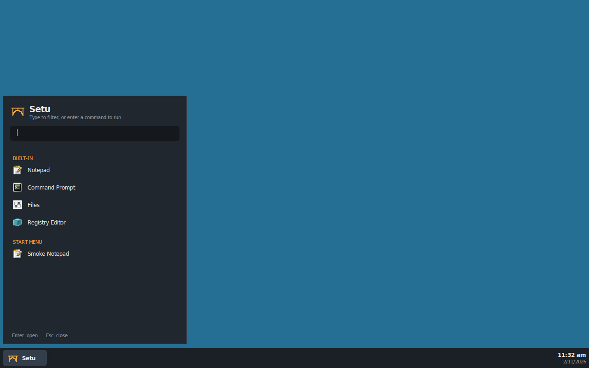

# shell/: Setu desktop shell

License: MIT OR Apache-2.0. **Status: Milestone 1 taskbar + launcher.**

The shell is a plain **Win32 application** (mingw-w64, C) that runs on the
Setu personality. It only uses public, documented APIs from user32, gdi32,
shell32, ole32 and kernel32, so it doubles as a test of the personality
(docs/ARCHITECTURE.md §3.4).



## What it does

- **Taskbar** docked to the bottom of the primary monitor. It registers as an
  appbar (`SHAppBarMessage`) and reserves the work area
  (`SPI_SETWORKAREA`) when the appbar alone doesn't.
- **Start button → launcher**: built-ins (Notepad, Command Prompt, Files =
  `explorer.exe`/`winefile.exe`, Registry Editor) plus every `.lnk` under the
  per-user and common Start Menu *Programs* folders (`SHGetFolderPathW`,
  resolved with `IShellLinkW`). Type to filter; if nothing matches, Enter
  runs the text as a command (`ShellExecuteExW`; `.msi` files fall back to
  `msiexec /i` if they have no file association).
- **Window buttons** for top-level windows, filtered by the documented
  taskbar rules (visible; `WS_EX_APPWINDOW` forces a button; owned or
  `WS_EX_TOOLWINDOW` windows get none). Click to activate, click the active
  one to minimize, click a minimized one to restore; right-click for
  Minimize/Restore/Close. Refreshed by `RegisterShellHookWindow` messages
  where that works, plus a timer.
- **Clock** in the tray area. Sizes scale with DPI (per-monitor aware).

The look is our own: slate bar, a warm accent, and a bridge mark drawn with
GDI. No Microsoft artwork, icons or fonts.

## Build

```sh
make -C shell          # -> build/shell/setu-shell.exe, build/shell/setu-probe.exe
```

Needs `x86_64-w64-mingw32-gcc`; the Makefile adds
`~/.local/setu-toolchain/bin` (from `tools/bootstrap-toolchain.sh`) to PATH.
The exe links only system DLLs.

## Run

```sh
wine build/shell/setu-shell.exe
```

Use the personality's `wine` (`build/personality/install/bin/wine`). For a
desktop-like session, give the prefix a virtual desktop so every program
shares it:

```sh
wine reg add 'HKCU\Software\Wine\Explorer' /v Desktop /d setu /f
wine reg add 'HKCU\Software\Wine\Explorer\Desktops' /v setu /d 1280x800 /f
```

The bootable dev image (distro/) runs the shell this way as its session:
`distro/build-image.sh --shell build/shell/setu-shell.exe`.

Running `setu-shell.exe` again with options forwards them to the running
shell (`WM_COPYDATA`):

| Option | Effect |
|---|---|
| `--open-launcher`, `--close-launcher`, `--toggle-launcher` | show/hide the launcher |
| `--launch NAME` | start a launcher entry |
| `--run CMD` | run a command, as typed in the launcher |
| `--state-file PATH` | write the shell's state for tests (Windows path) |
| `--reload` | rescan the Start Menu |
| `--exit-after SEC`, `--quit` | stop the shell |

## Test

```sh
tools/shell-smoke.sh               # exits nonzero on failure
tools/shell-smoke.sh --update-docs # also refresh shell/docs/*.png
```

The smoke test builds the shell, starts Xvfb and the shell in its own prefix
(`build/shell-prefix`), then checks: the taskbar is docked; a real click on
the start button opens the launcher with the built-ins and a test `.lnk`;
launching Notepad adds a taskbar button; the run box starts regedit; and
real clicks on the Notepad button activate, minimize and restore it.
Clicks are sent with `SendInput` by `shell/tests/setu-probe.exe`.
Screenshots land in `build/shell/smoke/`.

It then runs `shell/tests/setu-xproc.exe`, which checks personality
behaviour the shell relies on, each across two processes:

- `workarea`: with the shell's appbar docked, `SPI_GETWORKAREA` and the
  monitor's `rcWork` exclude the taskbar, a maximized window stays inside it,
  and with `ARW_HIDE` a minimized window is moved off screen.
- `shellhook`: `RegisterShellHookWindow` gets `HSHELL_WINDOWCREATED`,
  `HSHELL_WINDOWACTIVATED` and `HSHELL_WINDOWDESTROYED` for a child process's
  window.
- `icons`: the class icons (`GCLP_HICON`, `GCLP_HICONSM`) and `WM_GETICON` icon
  of a child process's window can be read and drawn (`GetIconInfo`,
  `DrawIconEx`).

## Known gaps (personality)

Found while building the shell:

- In the Xvfb virtual desktop, the area uncovered when a window is hidden or
  minimized isn't repainted (stale pixels from the launcher, or black).
  See the screenshots in `docs/`.
- Only icons of 64x64 or smaller can be drawn by another process; the shell
  falls back to the program's file icon for larger ones.

Fixed in the personality (checked by `setu-xproc`): the system-wide work area
(`ABM_SETPOS`, `SPI_SETWORKAREA`), cross-process window and class icons,
`ARW_HIDE`, and `RegisterShellHookWindow` (the shell still polls as a
fallback).

## References

learn.microsoft.com: *Using Application Desktop Toolbars*, *The Taskbar*
(Managing Taskbar Buttons), *Shell Links*, `SHAppBarMessage`,
`SHGetFolderPathW`, `ShellExecuteExW`, `SHDefExtractIconW`,
`RegisterShellHookWindow`, `SystemParametersInfoW` (`SPI_SETWORKAREA`,
`SPI_SETMINIMIZEDMETRICS`), `SetForegroundWindow`, `WM_COPYDATA`,
`SetProcessDpiAwarenessContext`, *User Objects*.
