# shell/: Setu desktop shell

License: MIT OR Apache-2.0. **Status: Milestone 3 taskbar + start menu.**

The shell is a plain **Win32 application** (mingw-w64, C) that runs on the
Setu personality. It only uses public, documented APIs from user32, gdi32,
shell32, ole32, advapi32 and kernel32, so it doubles as a test of the
personality (docs/ARCHITECTURE.md §3.4).

| | |
|---|---|
| 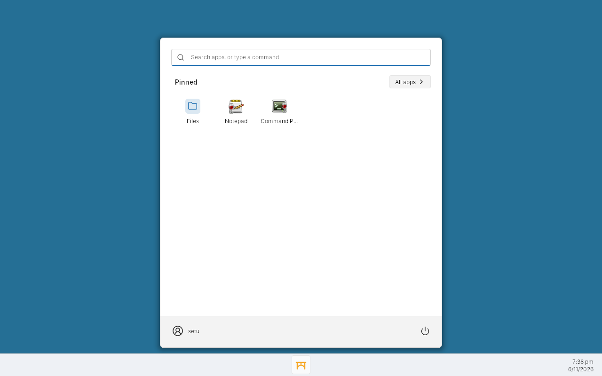 | 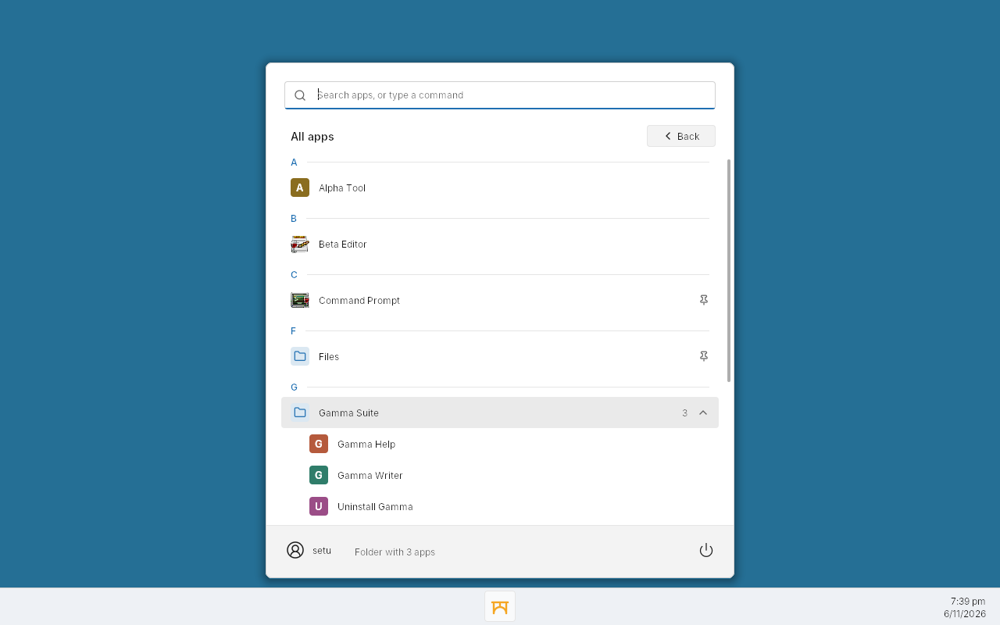 |

## What it does

- **Taskbar** docked to the bottom of the primary monitor, 48 px. It
  registers as an appbar (`SHAppBarMessage`) and reserves the work area
  (`SPI_SETWORKAREA`) when the appbar alone doesn't. The Setu button and the
  window buttons are centred; `TaskbarAlignment` = 1 (REG_DWORD) in
  `HKCU\Software\Setu\Shell` puts them on the left (read at start and on
  `--reload`).
- **Start menu** (start button, the Windows key on its own, or Ctrl+Esc): a
  floating panel above the taskbar with a search box, the pinned apps and an
  **All apps** button; the user (opens the home folder) and a power button
  (Sign out, Restart, Shut down) are at the bottom.
  - **All apps**, A to Z under letter headers: the built-ins (Files =
    `setu-files.exe`, else `explorer.exe`/`winefile.exe`; Notepad, Command
    Prompt, Registry Editor) plus every `.lnk` and `.url` under the per-user
    and common Start Menu *Programs* folders and their subfolders
    (`SHGetFolderPathW`, `IShellLinkW`, names from `SHGetFileInfoW`). A link
    in both folders is listed once (the per-user one wins). A folder with
    several apps is a group you can expand (nested folders are folded into
    it); a folder with one app just shows the app. `.appref-ms` (ClickOnce)
    isn't listed: its format isn't publicly documented.
  - **Other apps**: programs in the `Uninstall` keys (HKCU, HKLM, both
    registry views) that no shortcut belongs to. `SystemComponent` entries
    are hidden. A shortcut belongs to an entry by name, folder name,
    `InstallLocation`, or the folder of `UninstallString`/`DisplayIcon`.
  - **Icons** from the link's icon location, else the target's own icon or
    its file association (`SHDefExtractIconW`, `SHGetFileInfoW`), cached per
    file, index and size and sized for the DPI. Apps without an icon get a
    lettered tile of our own.
  - **Search**: type to filter (name prefix first, then word starts, then
    anywhere, then folder name); Enter starts the best match. If nothing
    matches, Enter runs the text as a command (`ShellExecuteExW`; `.msi`
    files fall back to `msiexec /i` if they have no file association).
  - **Pinned** grid (6 columns, up to 24; Files, Notepad, Command Prompt to start with):
    right-click an app for Open, Pin/Unpin, Open file location
    (`setu-files.exe "<folder>"`, else `explorer /select`) and Uninstall
    (runs the `UninstallString`). Pins live in `HKCU\Software\Setu\Shell`,
    value `Pinned` (REG_MULTI_SZ, in order).
  - **Keyboard**: arrows move through the pins; Up from the top row reaches
    the All apps / Back button, and Enter there switches views. In the list,
    arrows move through the rows and Left/Right collapse and expand groups.
    Tab reaches the user and power buttons. Enter opens, the Menu key or
    Shift+F10 opens the context menu, Esc closes.
  - **Power**: Sign out is `ExitWindowsEx(EWX_LOGOFF)`; the shell exits with
    0 on `WM_ENDSESSION`, which ends the session (distro/setu-session).
    Restart and Shut down run `systemctl reboot` / `poweroff` through `Z:`
    and are greyed out where there is no systemctl.
  - **Refresh**: when an installer adds or removes shortcuts or Uninstall
    entries, the menu updates within a second, open or not
    (`FindFirstChangeNotificationW` on both Programs folders,
    `RegNotifyChangeKeyValue` on the Uninstall keys, plus
    `SHChangeNotifyRegister`).
- **Window buttons** for top-level windows, filtered by the documented
  taskbar rules (visible; `WS_EX_APPWINDOW` forces a button; owned or
  `WS_EX_TOOLWINDOW` windows get none). Click to activate, click the active
  one to minimize, click a minimized one to restore; right-click for
  Minimize/Restore/Close. Each button is 40 px with a 24 px icon, a tooltip
  with the title, and an accent pill under running apps (long for the
  active one). Refreshed by `RegisterShellHookWindow` messages where that
  works, plus a timer.
- **Clock** (time over date) in the tray area. Sizes scale with DPI
  (per-monitor aware).

## Look

The shell and the file manager follow docs/DESIGN.md, Setu's own design:
light surfaces, one accent colour, rounded corners. No Microsoft artwork,
icons or fonts.

- **Design tokens**: every colour, size, font and icon comes from the active
  theme pack (docs/THEMES.md), read by `src/setu-theme.c`; the built-in
  values are setu-light's, from DESIGN.md. `src/setu-style.h` turns them into
  the palette (`ST`), the `ST_*` metrics (scaled for DPI) and the fonts, and
  has the drawing both programs share: anti-aliased rounded rectangles,
  frames and soft shadows on a 32-bit DIB (from a signed distance), text,
  and icons.
- **Type**: the pack's `[Fonts] ui` list; in setu-light, Inter (body 9 pt,
  captions 9 pt semibold, titles 10.5 pt semibold, large 14 pt semibold)
  when the system has it (the image installs fonts-inter), else the
  system's message font.
- **Icons**: [Lucide](https://lucide.dev) line icons (ISC licence,
  `icons/lucide/LICENSE`). The unmodified SVGs are in `icons/lucide/`;
  `icons/gen-icons.py` flattens them into stroke segments in
  `src/setu-icons.h` (`python3 shell/icons/gen-icons.py >
  shell/src/setu-icons.h` after adding one), and they are rasterized at the
  size needed, 1.5 px strokes at 24 px. The Setu bridge mark on the start
  button is drawn the same way. These are the fallbacks: every icon is
  looked up by name (distro/themes/ICONS.md) in the pack first, and the
  pack's monochrome icons are recoloured like the glyphs.
- **Start menu shadow**: Wine's virtual desktop has no translucent windows,
  so the menu copies what is under it before it opens and draws the shadow
  and the rounded corners over that copy. When the copy fails, it is a
  window with a rounded region instead.

Before/after screenshots of this restyle: `docs/m3-before/` holds the old
look.

## Theme packs

Both programs read the active pack at start: the id in
`HKCU\Software\Setu\Theme\Current`, found in
`%LOCALAPPDATA%\Setu\Themes\<id>` and then
`C:\Windows\Resources\Themes\<id>`, with `Base=` packs filling in what it
leaves out, then the built-in setu-light values. They reload and repaint
live on `WM_SETTINGCHANGE` with "SetuTheme" or "ImmersiveColorSet" and on
`WM_THEMECHANGED`. The state files have `theme=` and `theme_reloads=`
lines.

`setu-theme.exe` (`src/setu-theme-tool.c`, a console program) switches
packs:

```sh
wine build/shell/setu-theme.exe list              # installed packs, * = active
wine build/shell/setu-theme.exe current           # the active pack's id
wine build/shell/setu-theme.exe check DIR         # validate a pack; exit 2 on errors
wine build/shell/setu-theme.exe apply ID          # switch now
wine build/shell/setu-theme.exe apply --login ID  # at login: write settings, no broadcasts
```

`check` validates every value (colours, numbers, `Mode`, smoothing, the
taskbar alignment), that the icon files exist and load, the `.theme` file's
paths, and contrast: text on surface, and accent-text on accent, must be
at least 4.5:1. `apply` runs the steps of docs/THEMES.md with documented
APIs only:

1. `Current`.
2. `ThemeManager` (the control theme).
3. Every token in `HKCU\Software\Setu\Theme\Colors` and `\Metrics`,
   for the window frames; then `Control Panel\Colors` and `SetSysColors`.
4. The wallpaper, through `SPI_SETDESKWALLPAPER`. A JPEG or PNG is first
   converted to a BMP with WIC. At login, a wallpaper the user chose is
   kept.
5. The font overrides and font smoothing.
6. `Shell Icons`.
7. The `WM_THEMECHANGED` and `WM_SETTINGCHANGE` broadcasts.

Exit codes: 0 ok, 1 usage, 2 pack not found or invalid, 3 a step failed.

| setu-light | a throwaway pack (red accent, own folder and start button icons) |
|---|---|
| 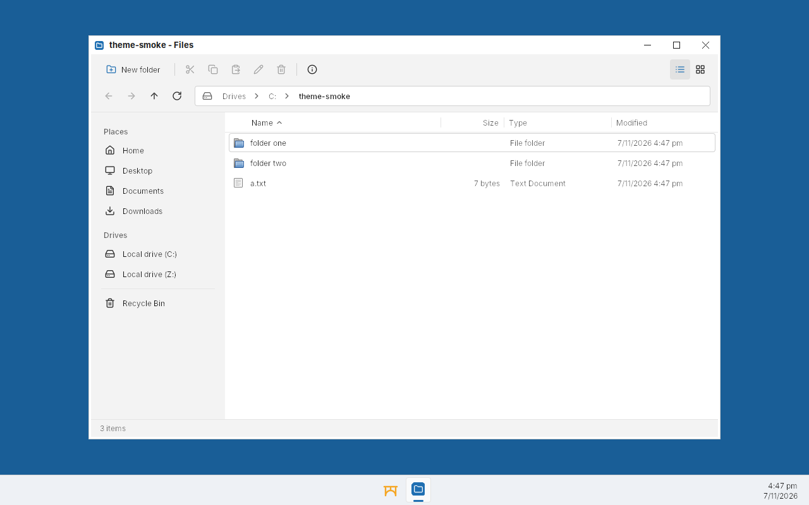 | 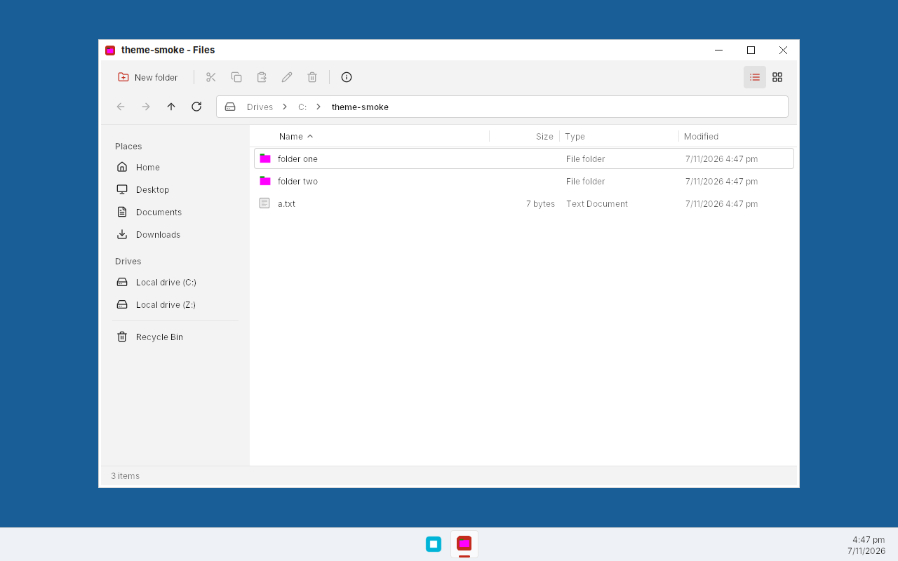 |

`tools/theme-smoke.sh` takes these screenshots. In its own Xvfb, it:

- builds that pack and an invalid one;
- checks `list`, `current` and `check`;
- applies the pack while setu-shell and setu-files run, then checks the
  registry and counts accent and icon pixels to confirm both repainted;
- applies setu-light again and checks that everything went back.

## Build

```sh
make -C shell          # -> build/shell/setu-shell.exe, build/shell/setu-probe.exe
```

Needs `x86_64-w64-mingw32-gcc`; the Makefile adds
`~/.local/setu-toolchain/bin` (from `tools/bootstrap-toolchain.sh`) to PATH.
The exe links only system DLLs.

## Run

```sh
wine build/shell/setu-shell.exe
```

Use the personality's `wine` (`build/personality/install/bin/wine`). For a
desktop-like session, give the prefix a virtual desktop so every program
shares it:

```sh
wine reg add 'HKCU\Software\Wine\Explorer' /v Desktop /d setu /f
wine reg add 'HKCU\Software\Wine\Explorer\Desktops' /v setu /d 1280x800 /f
```

The bootable dev image (distro/) runs the shell this way as its session:
`distro/build-image.sh --shell build/shell/setu-shell.exe`.

Running `setu-shell.exe` again with options forwards them to the running
shell (`WM_COPYDATA`):

| Option | Effect |
|---|---|
| `--open-launcher`, `--close-launcher`, `--toggle-launcher` | show/hide the start menu |
| `--launch NAME` | start a menu entry |
| `--run CMD` | run a command, as typed in the search box |
| `--search TEXT` | open the menu and type TEXT into the search box |
| `--pin NAME`, `--unpin NAME` | pin or unpin a menu entry |
| `--state-file PATH` | write the shell's state for tests (Windows path) |
| `--reload` | rescan the Start Menu and the Uninstall keys |
| `--exit-after SEC`, `--quit` | stop the shell |

## Test

```sh
tools/shell-smoke.sh               # exits nonzero on failure
tools/shell-smoke.sh --update-docs # also refresh shell/docs/*.png
tools/theme-smoke.sh               # theme packs and setu-theme.exe
```

The smoke test builds the shell, starts Xvfb and the shell in its own prefix
(`build/shell-prefix`), then checks: the taskbar is docked; a real click on
the start button opens the launcher with the built-ins and a test `.lnk`;
launching Notepad adds a taskbar button; the run box starts regedit;
real clicks on the Notepad button activate, minimize and restore it; and the
desktop is repainted where the closed launcher and the minimized Notepad
were (pixels sampled there must match the desktop background); and the
buttons are centred, and on the left with `TaskbarAlignment` = 1.
Clicks are sent with `SendInput` by `shell/tests/setu-probe.exe`, which also
lists the top-level windows (`setu-probe windows [all]`).
Screenshots land in `build/shell/smoke/`.

It then runs `shell/tests/setu-xproc.exe`, which checks personality
behaviour the shell relies on, each across two processes:

- `workarea`: with the shell's appbar docked, `SPI_GETWORKAREA` and the
  monitor's `rcWork` exclude the taskbar, a maximized window stays inside it,
  and with `ARW_HIDE` a minimized window is moved off screen.
- `shellhook`: `RegisterShellHookWindow` gets `HSHELL_WINDOWCREATED`,
  `HSHELL_WINDOWACTIVATED` and `HSHELL_WINDOWDESTROYED` for a child process's
  window.
- `icons`: the class icons (`GCLP_HICON`, `GCLP_HICONSM`) and `WM_GETICON` icon
  of a child process's window can be read and drawn (`GetIconInfo`,
  `DrawIconEx`).

`tools/startmenu-smoke.sh [--update-docs] [--keep]` tests the start menu in
a throwaway prefix (`build/startmenu-prefix`), with shortcuts and Uninstall
entries pointing at `shell/tests/setu-testapp.exe`: discovery (both Programs
folders, subfolders, groups, de-duplication, icons and glyphs, Other apps,
hidden system components), the Windows key and typing to search, Enter on
the best match, Ctrl+Esc, arrow keys through the pins, the All apps button
(by keyboard and by mouse) and the rows, Esc, expanding a group, a shortcut
added and removed while the menu is open, right-click > Pin (and the
registry value), right-click > Uninstall, the command fallback, and the pin
after a restart. Keys and clicks are real input (`setu-probe key`, `type`,
`click`, `rclick`). Screenshots: `shell/docs/startmenu-*.png`.

## Known gaps (personality)

Found while building the shell:

- Only icons of 64x64 or smaller can be drawn by another process; the shell
  falls back to the program's file icon for larger ones.
- `SHChangeNotify` only reaches `SHChangeNotifyRegister` windows in the same
  process, so the menu relies on `FindFirstChangeNotificationW` to hear
  installers (reported to shell-api).

Fixed in the personality (checked by `setu-xproc`): the system-wide work area
(`ABM_SETPOS`, `SPI_SETWORKAREA`), cross-process window and class icons,
`ARW_HIDE`, and `RegisterShellHookWindow` (the shell still polls as a
fallback).

Also fixed: in the virtual desktop, the area uncovered when a window was
hidden or minimized wasn't repainted (stale launcher pixels, or black). The
desktop window is drawn straight to X, and that drawing stayed buffered until
the next X event; winex11 now sends it when the thread goes idle
(`FlushOutput`). `tools/shell-smoke.sh` samples the vacated pixels after the
launcher closes and after Notepad is minimized.

## References

learn.microsoft.com: *Using Application Desktop Toolbars*, *The Taskbar*
(Managing Taskbar Buttons), *Shell Links*, `SHAppBarMessage`,
`SHGetFolderPathW`, `ShellExecuteExW`, `SHDefExtractIconW`,
`RegisterShellHookWindow`, `SystemParametersInfoW` (`SPI_SETWORKAREA`,
`SPI_SETMINIMIZEDMETRICS`), `SetForegroundWindow`, `WM_COPYDATA`,
`SetProcessDpiAwarenessContext`, *User Objects*; for the start menu:
*Uninstall Registry Key*, `ARPSYSTEMCOMPONENT`, `ARPPRODUCTICON`,
`FindFirstChangeNotificationW`, `RegNotifyChangeKeyValue`,
`SHChangeNotifyRegister`, `RegisterHotKey`, `LowLevelKeyboardProc`,
`SHGetFileInfoW`, `TrackPopupMenu`, `RegGetValueW`.

## Files (setu-files.exe)

`src/setu-files.c` is Setu's file manager; the launcher's **Files** entry
starts it. It's plain Win32, drawn with `src/setu-style.h` like the shell.

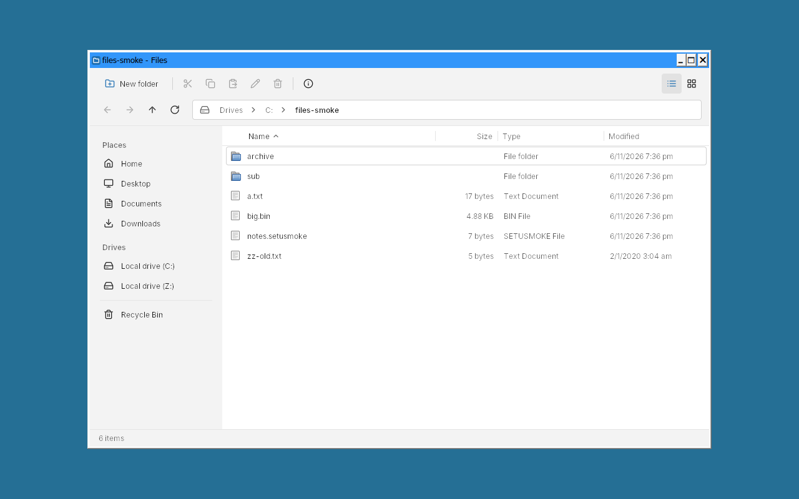

- **Browsing**: a sidebar with Home, Desktop, Documents and Downloads (known
  folders), the drives and the Recycle Bin (with its item count). The list has
  a details view (name, size, type, modified; click a header to sort) and an
  icons view. The address bar shows breadcrumbs (click one to go there);
  click beside them, Tab, Ctrl+L, Alt+D or F4 to type a path, `Drives` or
  `Recycle Bin`.
- **Command bar**: New folder (Empty Recycle Bin in the bin), Cut, Copy,
  Paste, Rename, Delete, Properties and the view switch, as icon buttons
  with tooltips; Back, Forward, Up and Refresh sit next to the address bar.
  Rows are 32 px and owner-drawn: the selection is the accent at 20 % with
  a 1 px accent outline (lighter, without the outline, when the list doesn't
  have the focus).
- **Opening**: Enter or a double-click. Folders open in place; files go to
  `ShellExecuteExW` with the default verb. **Open with…** lists the handlers
  from the association registry (`AssocQueryStringW`, `OpenWithProgids`,
  `OpenWithList`, `PerceivedType`). "Choose another program" saves the choice
  for the user under `HKCU\Software\Classes` (`Applications\<exe>`,
  `.ext\OpenWithList`, and a `Setu.Choice.*` ProgID when it should be the
  default).
- **File operations** use `SHFileOperationW`: new folder, in-place rename,
  copy, cut and paste (`CF_HDROP` with `Preferred DropEffect`, so they work
  with other programs), drag and drop onto a folder or a sidebar place, Delete
  to the Recycle Bin (`FOF_ALLOWUNDO`) and Shift+Del to delete for good.
  Progress and errors appear in the status bar. In the Recycle Bin view you
  can restore, delete or empty.
- **Compressed folders**: archives that the shell shows as folders
  (zipfldr in the personality: `.zip`, `.tar`, `.tar.gz`/`.tgz`, `.gz`)
  open in place like folders, and the address bar shows paths inside them
  (`C:\x\a.zip\docs`), which you can also type. Copy (Ctrl+C, then paste in
  a folder) or drag items onto a folder or a sidebar place to copy them out;
  folders copy recursively. **Extract All…** (on the archive, or inside it)
  runs the archive's `extract` verb. Archives are read-only here: no cut,
  rename, delete or paste into them. Types the personality can't read yet
  (7z, rar, bz2, xz, zst) open with their program instead.
- **Properties** (Alt+Enter) is our own window. It shows type, location, size
  (folders are counted in the background), the dates, and the read-only,
  hidden and archive attributes, which you can change.
- **Refresh**: our own operations reload the view, and
  `FindFirstChangeNotificationW` picks up changes made by other programs.

Keys: Alt+Left/Right/Up, Backspace, Enter, F2, Del, Shift+Del, Ctrl+C/X/V/A,
Ctrl+Shift+N, Alt+Enter, F5, Ctrl+L (or Alt+D, F4), Ctrl+1/2 (details/icons),
Ctrl+H (show hidden files) and Tab (moves between sidebar, list and address).

| | |
|---|---|
| 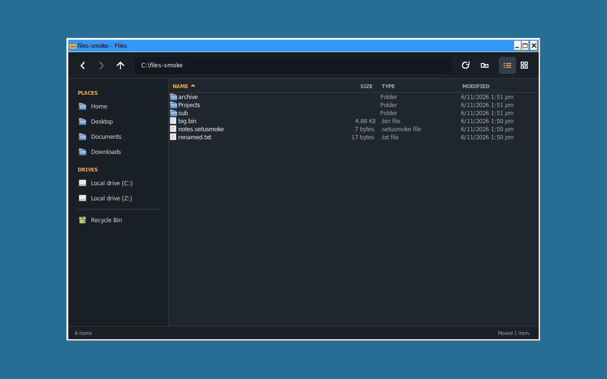 | 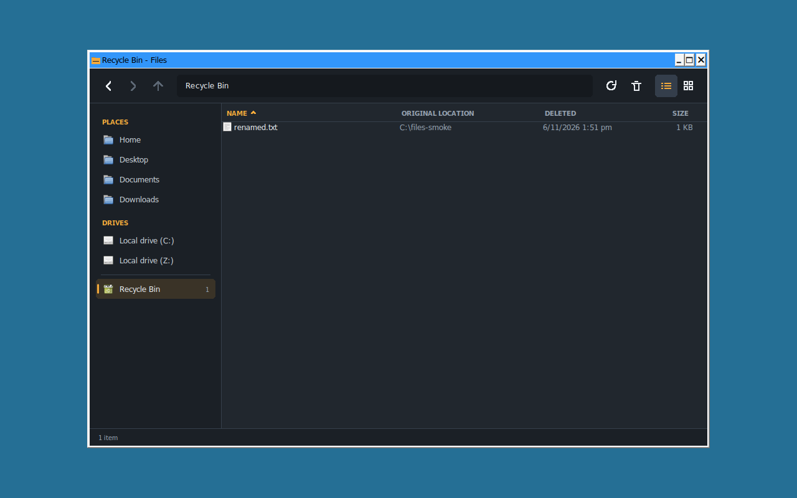 |
| 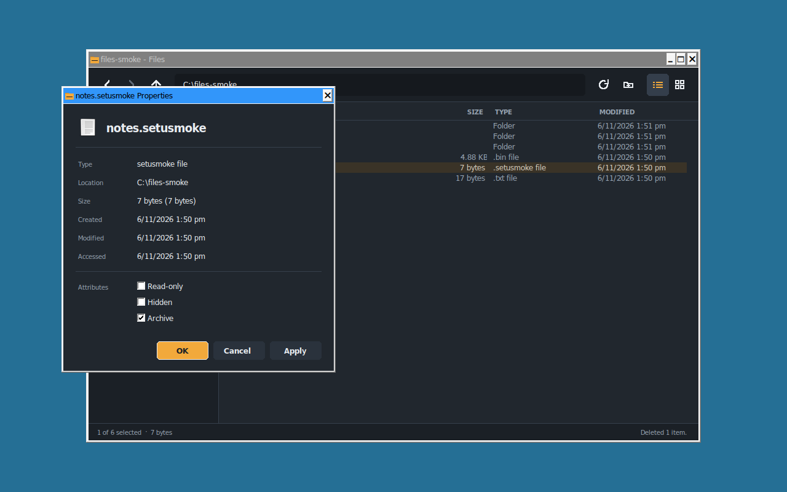 | 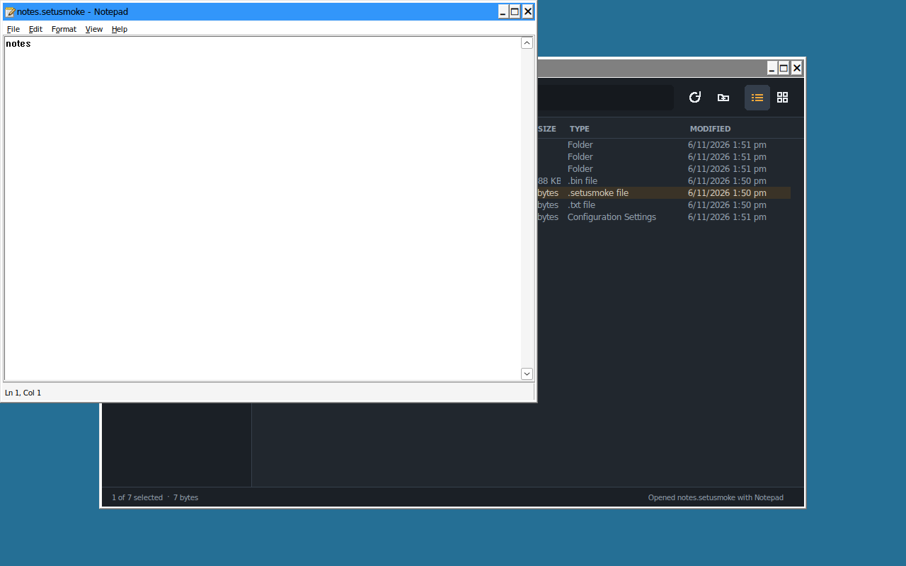 |
| 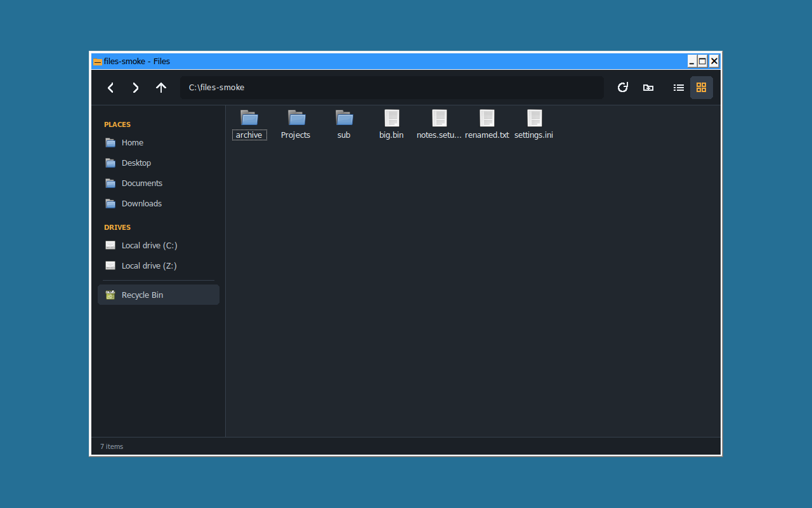 | 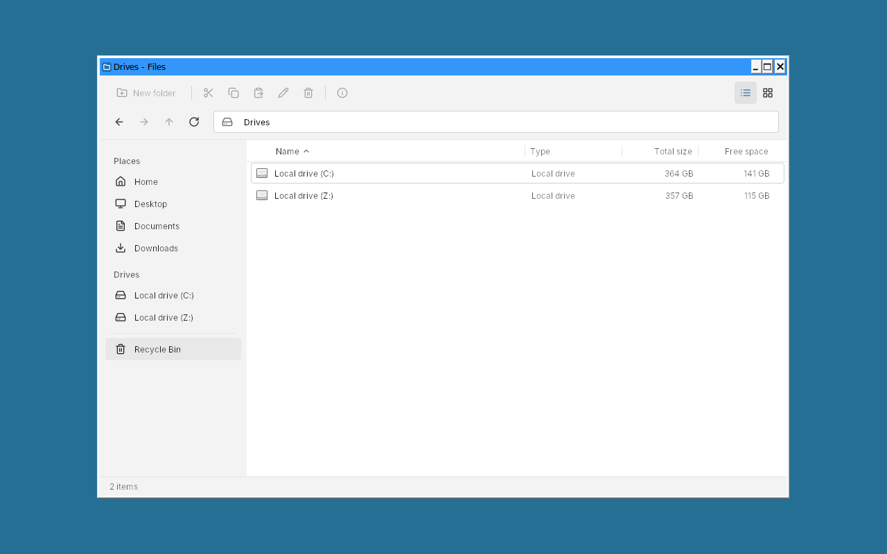 |
| 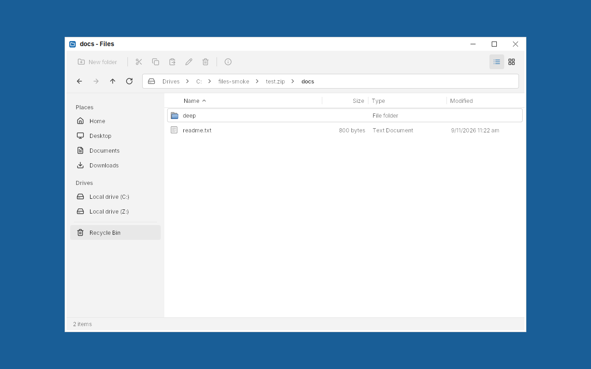 | |

**Test**: `tools/files-smoke.sh [--update-docs] [--keep]` runs under its own
Xvfb with a fresh prefix (`build/files-prefix`). It sets `HOME`/`XDG_*` to
`build/files-home`, so the Recycle Bin (the XDG trash) never touches yours,
and keeps the machine's disks out of the prefix (Wine's mount manager would
add them from udisks). It
drives the window with real keys and mouse (`setu-files-probe.exe`) and with
`WM_COPYDATA` commands, then reads the window's state file. It covers
browsing, sorting, new folder, rename, copy/paste, cut/paste, drag and drop, an
outside change, delete, restoring from the Recycle Bin, Shift+Del,
Properties, Open with and saving a choice, browsing, copying out of and
extracting compressed folders, the icons and Drives views, and
the launcher entry. Exit code 0 is PASS.

Personality gaps found (BUG-FOR shell-api, worked around here):
- `GetLogicalDrives` returns 0, so we probe `GetDriveTypeW` for each letter.
- `FOF_RENAMEONCOLLISION` is ignored, so we name the " - Copy" files
  ourselves.
- `SHFileOperationW` shows no progress dialog, and most of `IFileOperation`
  is a stub.
- The Recycle Bin's context menu has no string verbs.
- `wine.inf` doesn't map `.txt` to `txtfile`.
- A popup lying wholly inside another of the process's windows isn't painted,
  so Properties opens over the main window's left edge. The same bug blacks
  out the shell32 delete confirmation.

References (learn.microsoft.com): *Shell Namespace* / `IShellFolder2`,
`SHGetKnownFolderPath`, `SHFileOperationW` and `SHFILEOPSTRUCTW`,
*Shell Clipboard Formats*, `ShellExecuteExW`, `AssocQueryStringW`,
*Programmatic Identifiers*, *Registering an Application for Use with
Open With* (`OpenWithProgids`, `OpenWithList`), `SHQueryRecycleBinW`,
`SHEmptyRecycleBinW`, `FindFirstChangeNotificationW`, `GetDriveTypeW`,
`GetVolumeInformationW`, `GetDiskFreeSpaceExW`, *List-View Controls*
(custom draw, `LVN_BEGINDRAG`, label editing), *Drag lists and image lists*
(`ImageList_BeginDrag`), `SHAutoComplete`. Wine source was read for behaviour
only (comctl32 listview drag tracking, kernelbase drives).

## Desktop (setu-desktop.exe)

`src/setu-desktop.c` draws the wallpaper and the desktop's icons. The shell
starts it from its own folder at start (`--no-desktop` skips that), unless
one is already running. As on Windows, the icons sit in a window above the
desktop window: a full-screen `WS_POPUP` that stays at the bottom of the Z
order (`HWND_BOTTOM` forced in `WM_WINDOWPOSCHANGING`). The wallpaper is
drawn here too: user32 holds the wallpaper bitmap only in the desktop
process. It's loaded with WIC from `SPI_GETDESKWALLPAPER` and placed using
`WallpaperStyle`/`TileWallpaper`.

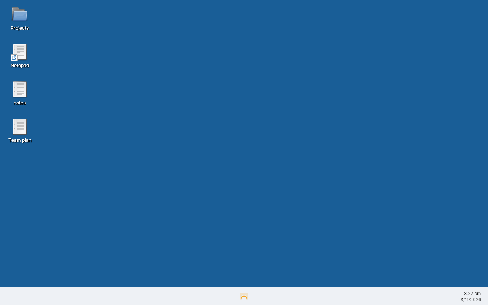

- **Items**: `FOLDERID_Desktop` merged with `FOLDERID_PublicDesktop`.
  Hidden and system items and `desktop.ini` are skipped. Labels and icons
  come from `SHGetFileInfoW` (display name, system image list at
  `SHIL_EXTRALARGE`). That hides known extensions, honours
  `Explorer\Advanced\HideFileExt`, drops ".lnk", shows a shortcut's target
  icon and applies the Shell Icons overrides. Shortcuts get a small arrow
  badge in the accent colour. Labels are white with a blurred shadow, and
  wrap to two lines.
- **Layout**: columns from the top left, top to bottom then left to right,
  inside the work area (so clear of the taskbar). Drag an icon to another
  cell; an icon already there swaps with it. Positions are remembered in
  `HKCU\Software\Setu\Desktop\Positions`. Desktop menu > Arrange by name
  forgets them.
- **Opening**: double-click or Enter. Folders (and shortcuts to folders)
  open in `setu-files.exe`; everything else goes to `ShellExecuteExW`
  "open".
- **Item menu**: Open, Rename (in place; a hidden extension is kept),
  Delete (`SHFileOperationW` with `FOF_ALLOWUNDO`, to the Recycle Bin;
  Shift+Del deletes for good) and Properties (the shell's `properties`
  verb).
- **Desktop menu**: Arrange by name, Refresh, Paste (`CF_HDROP`), New >
  Folder / Text Document (created at the click and named in place), and
  Open Desktop folder (setu-files).
- **Live refresh**: `ReadDirectoryChangesW` on both folders. A change shows
  within about 0.2 s. `SHChangeNotifyRegister` reloads the icons after an
  association or icon change. Theme switches, wallpaper changes
  (`SPI_SETDESKWALLPAPER`) and work-area changes are followed.
- Keys: arrows, Enter, F2, Del, Shift+Del, F5, Esc, Ctrl+V, Shift+F10 or the
  menu key. Files dropped from other programs (`WM_DROPFILES`) are moved, or
  copied when they come from another drive.

| | |
|---|---|
| 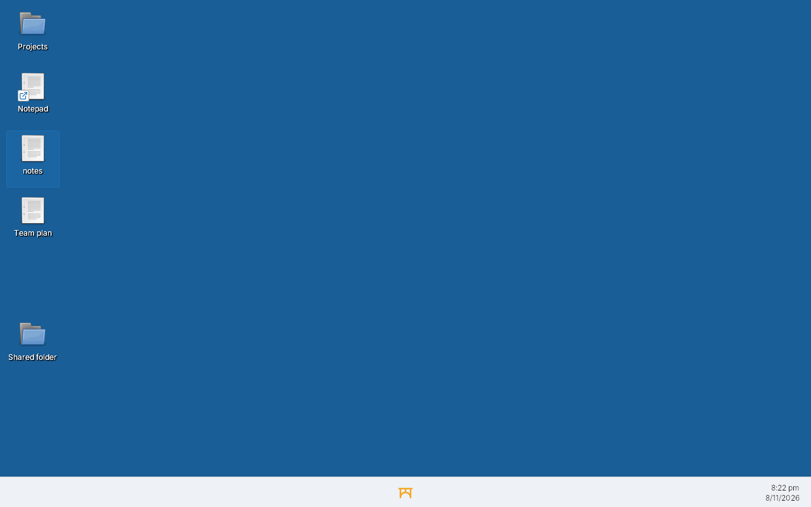 | 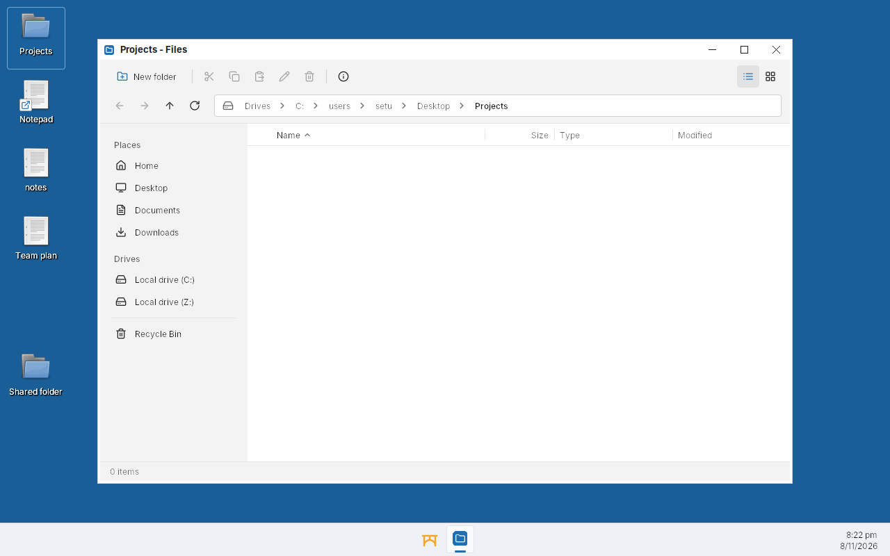 |
| 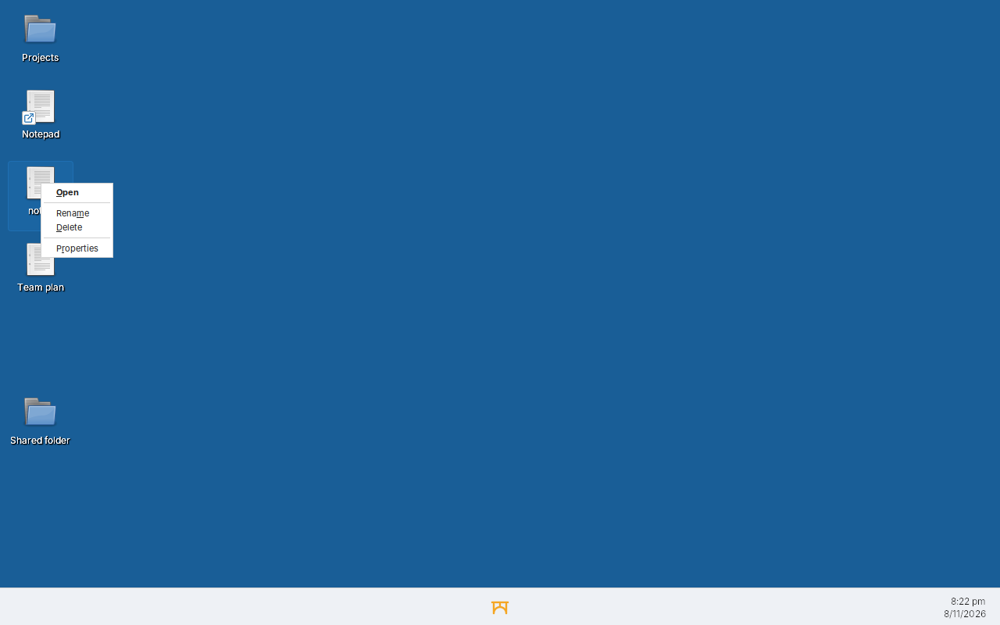 | 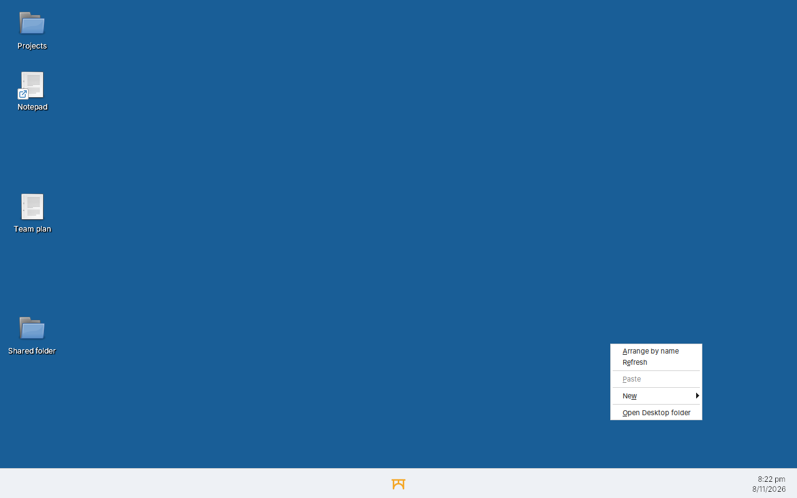 |

Explorer's own desktop launchers (`.lnk` only) still run underneath, hidden
by this window.

**Test**: `tools/desktop-smoke.sh [--update-docs] [--keep]` runs under its
own Xvfb, with a fresh prefix (`build/desktop-prefix`) and home. It puts a
text file, a folder, a shortcut, a hidden file and `desktop.ini` on the
Desktop and a file on the Public Desktop. Then it checks:
- the items and HideFileExt;
- the layout against the work area;
- the drawn icons, labels and shadows (pixel checks);
- live create, rename and delete;
- click and arrow selection, including the accent highlight;
- double-click opening a folder in setu-files, and Enter on a shortcut;
- the item menu (Rename, Delete to the Recycle Bin), F2 and Escape;
- the desktop menu (New > Folder, New > Text Document, Open Desktop folder);
- dragging an icon, and that its position is remembered after a restart.

Personality fix that came with it: in a virtual desktop, Wine's X11 driver
only ever raised X windows, and raised every window that got the focus. So
`HWND_BOTTOM` didn't lower the desktop, a click put it over the taskbar, and
activating a window didn't bring it to the top of the Z order. winex11.drv
now stacks each top-level window of a virtual desktop just below the window
before it in the Z order. It also brings an activated window to the top,
unless the window refuses in `WM_WINDOWPOSCHANGING`.

References (learn.microsoft.com): *KNOWNFOLDERID*, `SHGetKnownFolderPath`,
`SHGetFileInfoW`, `SHGetImageList`, `ShellExecuteExW`,
`ReadDirectoryChangesW`, `SHChangeNotifyRegister`, `SHFileOperationW`,
`SystemParametersInfoW` (`SPI_GETDESKWALLPAPER`, `SPI_GETWORKAREA`),
`SetWindowPos`, `WM_WINDOWPOSCHANGING`, `DESKTOP_WALLPAPER_POSITION`,
*Windows Imaging Component*. Wine source was read for behaviour only
(explorer's desktop, shell32 display names).
